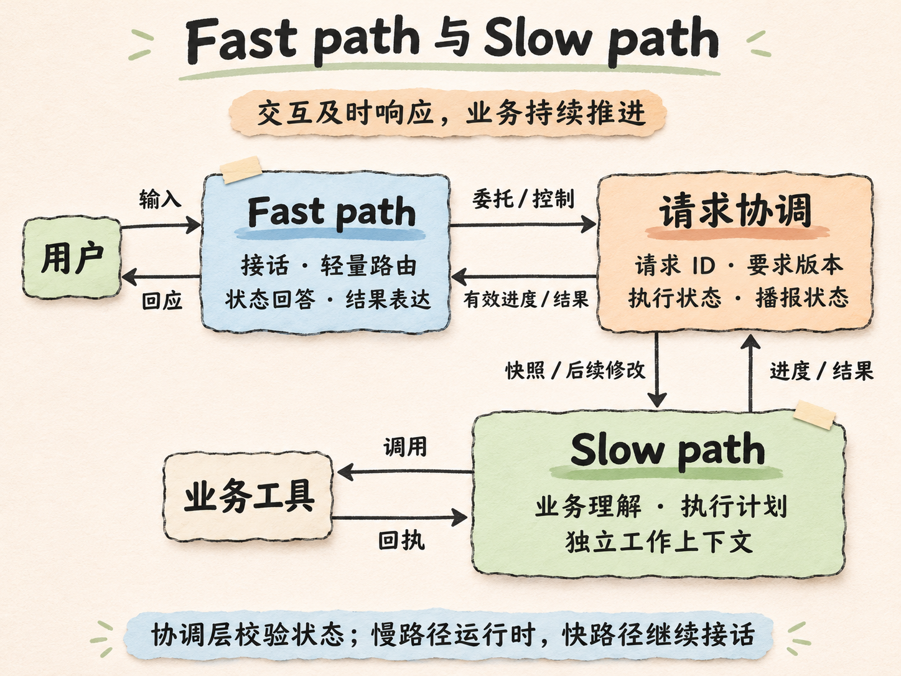
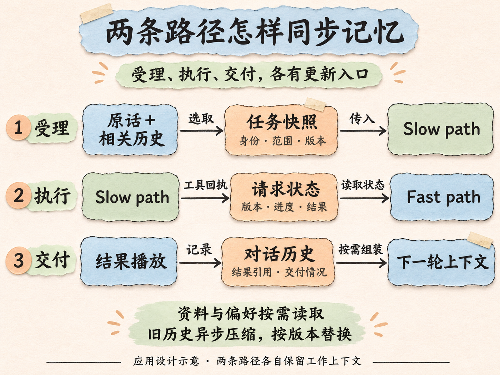

# v2 配图原文依据

来源：[第三篇 Markdown](../../voice-agent-03-background-memory.md)。以下为当前配图相关章节，图片路径按本目录调整。

## 一项请求怎样在两条路径之间推进

把前面的机制放回会议场景，可以得到下面这条协作链。图中的协调层维护请求关联与状态，具体实现可以使用框架组件或应用自己的运行时。

*图 1：两条路径并行推进，通过请求协调层关联任务、控制动作和结果。*

### 受理：先固定请求，再启动后台工作

用户提出整理行动项时，应用记录原话、身份、资料范围和相关对话，建立请求 ID。慢路径拿到这份输入后开始执行，快路径根据受理结果给出简短回应。

这次回应表示系统已经收到请求。任务阶段和成功结果继续由后台的真实进展更新。执行期间没有新进度时，助手可以保持安静，等待用户追问或结果返回。

### 修改：保持请求关联，更新要求版本

用户补充“先整理发布相关的”后，路由判断将它接到当前请求。协调层增加要求版本，把新条件送入慢路径。

后续动作需要结合旧版本所处阶段处理：

| 旧版本的操作阶段 | 处理方式 |
|---|---|
| 仍在分析，尚未提交写入 | 中止旧计划，按新要求继续 |
| 写入已经发出 | 收取回执，保留业务 ID，再确定修改动作 |
| 写入结果未知 | 查询实际业务状态，确认后继续 |

请求版本用于识别过期计划，工具回执用于确认已经发生的事实。即使旧结果不再适合直接播报，其中已经成功写入的业务记录仍需要保留和核对。

### 查询与澄清：让下一句话进入正确入口

“整理好了吗”可以读取已有请求状态，快路径据此回答，无需重新启动整项分析。如果后台需要补充条件，则先记录一个关联当前请求的待答问题，再安排播报。

用户回答后，应用将输入关联到这个问题，让原任务继续。期间收到普通聊天或新的修改要求，也需要分别路由，避免把每句发言都当成澄清答案。

### 交付：结果完成后，再安排表达

慢路径完成后，协调层先保存结果、来源和要求版本。交付时检查结果是否仍有效，以及用户是否正在讲话，再决定播报时机。

执行和交付分别记录，可以区分几种状态：

- 后台仍在处理。
- 已有有效结果，等待播报。
- 结果正在播报，或中途被打断。
- 本次结果已完成交付。

下一轮追问同时使用请求状态和对话历史，才能区分“已经做完”和“已经告诉用户”。

## 记忆分别保存，按用途进入上下文

两条路径需要的信息不同。快路径回答进度，只需当前阶段和可交付结果；慢路径整理行动项，需要转写、筛选条件和工具返回值。把所有工作记录反复塞进前台，会增加每轮读取的信息量，也容易混入过期计划。

### 对话、请求和业务事实分别记录

| 信息 | 保存内容 | 主要用途 |
|---|---|---|
| 对话历史 | 用户原话、助手表达、交付情况、较早摘要 | 解释下一轮指代与上下文 |
| 后台工作上下文 | 当前任务材料、工具调用及结果 | 支持慢路径继续推理 |
| 请求状态 | 请求 ID、要求版本、阶段、待答问题、交付状态 | 协调输入、执行和播报 |
| 业务记录 | 转写、资料、提案、持久作业与回执 | 查询真实结果，核对当前版本 |
| 长期偏好 | 用户明确要求跨会话采用的习惯 | 在后续任务中提供默认条件 |

每类信息都可以有自己的保存期限。需要跨进程恢复的内容必须持久保存；当前模型上下文则从保留的记录中按需构建。

### 同步围绕任务快照、状态更新和交付记录展开

*图 2：同步发生在受理、执行和交付三个时机。应用选择需要传递的信息，两边各自保留工作上下文。*

沿着一次请求，记忆这样更新：

1. **受理时传入快照。** 从历史中取出相关对话，加上本轮原话、身份和资料范围，供慢路径开始工作。后续修改通过明确入口追加。
2. **执行时回传状态。** 工具结果保留在后台工作记录中，同时更新请求阶段、业务 ID 和可交付结果。快路径读取这份状态回答追问。
3. **交付后更新历史。** 保存后续理解需要的结果摘要或来源引用，并记录是否完整交付。新一轮构建上下文时读取最新记录。

例如，用户追问“刚才那项行动由谁负责”，对话历史帮助定位行动项，业务记录提供当前负责人。提案可能已经被修改，动态内容需要重新读取。

Codex 的语音历史提供了一个具体参考：它记录转写，也保存输入与执行轮次的关联；语音启动上下文则选取近期问答和工作环境。持久记录与模型当前可见的信息分别管理。[历史保存源码](https://github.com/openai/codex/blob/65a5410f72dac1f4b40862c34ef0a8b71b12834a/codex-rs/core/src/session/realtime_history.rs)、[语音上下文源码](https://github.com/openai/codex/blob/65a5410f72dac1f4b40862c34ef0a8b71b12834a/codex-rs/core/src/realtime_context.rs)

### 历史压缩和长期记忆提取放到后台

较长会话可以保留近期原文，将较早片段异步压缩成摘要。压缩期间仍会有新消息，因此摘要返回后要核对旧片段及其版本，只替换仍然匹配的部分，保留后来追加的内容。请求状态和工具回执继续使用各自的记录。

长期记忆提取还有另一种节奏。Mem0 的语音记忆指南比较了逐轮提取和会话结束后提取；Retell 则提供通话完成后更新联系人简报、下次会话加载的产品实践。[Mem0 架构指南](https://mem0.ai/library/agent-memory/ai-memory-for-voice-agents)、[Retell 记忆说明](https://www.retellai.com/blog/ai-voice-agent-memory)

| 提取方式 | 适用情况 | 需要承担的代价 |
|---|---|---|
| 每轮后异步提取 | 后续轮次很快要使用新偏好或事实 | 调用更频繁，需要合并重复与修正 |
| 会话结束后统一提取 | 为下次交流准备简报 | 当前会话继续依赖历史，提取任务需要可靠触发 |

需要恢复能力时，可以先持续保存原始交互，再异步提取；提取失败后从已保存的原文补做。读取时，简短稳定的偏好可以在会话开始加载，任务资料按需检索，动态业务状态查询原服务。

