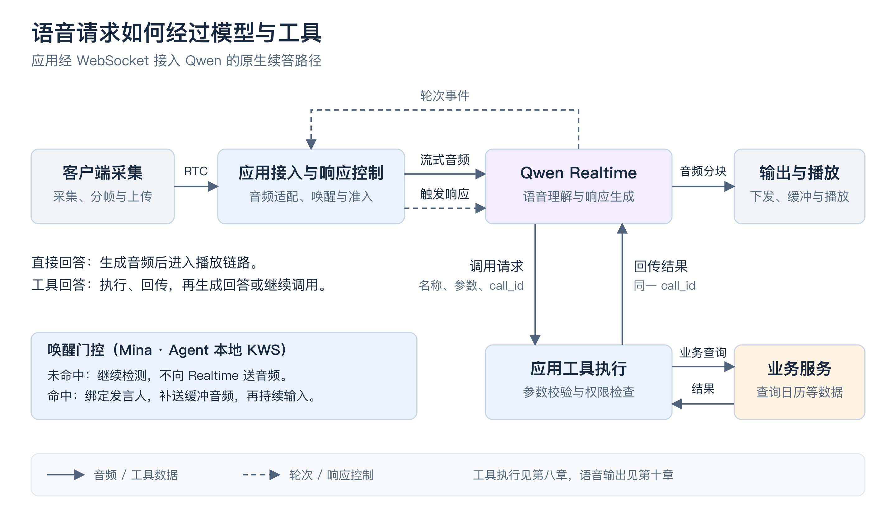
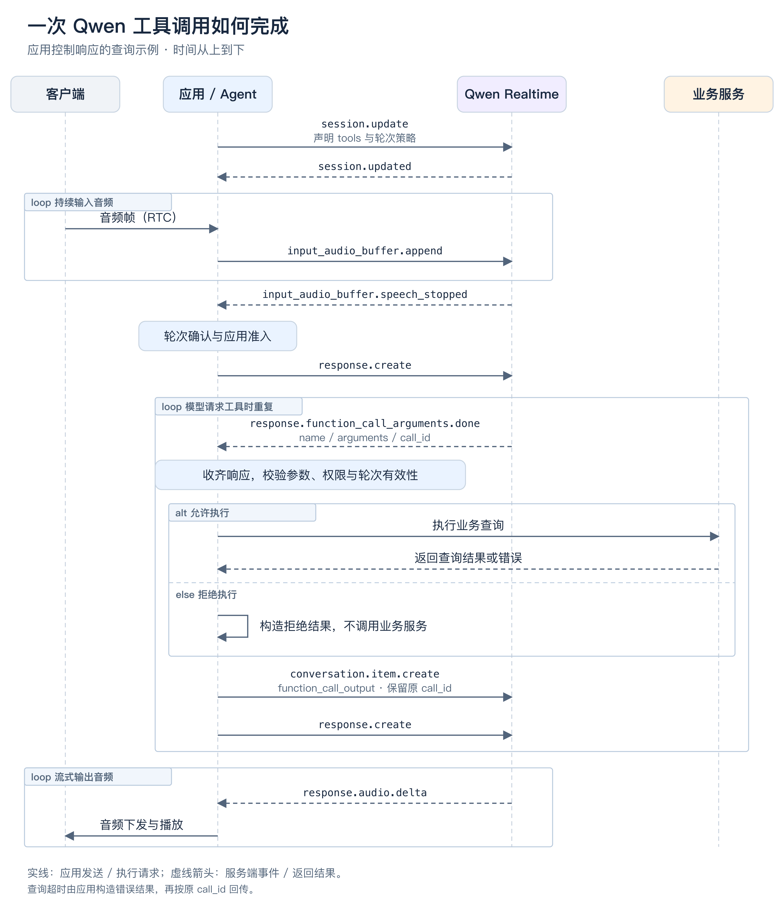

# Voice Agent 实践与落地（二）：从唤醒到多轮对话，拆解实时语音链路

在 Mina 里，用户说一句“米娜，查一下今天的会议”，背后涉及唤醒、音频传输、轮次判断、模型响应、工具执行和播放。第一轮结束后，用户还可能继续问“都有谁参加”，或者在回答途中补一句“只看下午的”。

要解释这些行为，需要沿着一段对话往下看：每个阶段收到什么，做了什么判断，满足什么条件才能进入下一步。本文以 Qwen Realtime 为主线，在对应阶段对照 Pipecat、TEN、LiveKit 和豆包的实现。

## 一、先看完整过程：一次唤醒，两轮对话

下面用一段示意对话贯穿全文，会议信息仅用于说明链路：

> 用户：米娜，查一下今天的会议……下午最近的一场。
>
> Mina：下午三点有一场项目评审。
>
> 用户：都有谁参加？
>
> Mina：我查一下这场会议的参会名单。

第一句里的“米娜”负责唤醒；中间的停顿考验轮次判断；查询会议需要调用工具；第二轮的“谁参加”则依赖上一轮确认的会议。

从应用控制的角度，可以将过程拆成：

```text
等待唤醒 → 会话准备与发言准入 → 音频输入
                                  ↓
                         VAD 检测 → 轮次结束判断
                                  ↓
                         组织上下文、触发响应
                                  ↓
                  直接回答，或执行工具 → 回传结果并续答
                                  ↓
                              流式播放
                                  ↓
             继续追问 → 回到音频输入；超时退出 → 等待唤醒
```

这是讲解顺序，并不表示每一步都要等前一步完全结束。采集、传输和模型接收会重叠；VAD 在输入期间持续运行；打断可以发生在模型生成、工具执行或播放过程中。

### 本文采用哪种语音架构

级联式 Voice Agent 将语音依次交给 ASR、文本模型和 TTS；原生 Realtime 模型直接接收音频并生成音频。前者可以独立选择各个组件，后者能够利用语气等转写难以完整保留的信息，减少模块间转换。两种架构都可以流式运行。[LiveKit Realtime 模型说明](https://docs.livekit.io/agents/models/realtime/)

Mina 使用 Qwen Realtime，是因为它提供流式音频输入输出、会话控制和 Function Calling，能接入现有业务编排。本文以代码默认的 `qwen3.8-omni-flash-realtime`、WebSocket 接入方式为例；工具由应用执行。[Qwen Realtime 文档](https://help.aliyun.com/zh/model-studio/omni-realtime-api)

框架与模型也要分清。Pipecat 通过 Frame 和 Processor 组织 Pipeline；LiveKit Agents 通过 `AgentSession` 管理输入、模型调用和输出。LiveKit 的 RTC 传输层可以供 Pipecat 使用，因此“用了 LiveKit 传音频”和“用了 LiveKit Agents 编排”是两件事。[Pipecat Frames](https://github.com/pipecat-ai/docs/blob/main/api-reference/server/frames/overview.mdx)、[LiveKit AgentSession](https://docs.livekit.io/agents/logic/sessions/)、[Pipecat LiveKit Transport](https://docs.pipecat.ai/api-reference/server/services/transport/livekit)

Mina 当前使用 Agora 传输音频，并有 Qwen、豆包的自定义实时适配。下图展示 Qwen 路径中应用、模型与业务服务的边界，后面的章节逐步展开。



应用负责控制交互、执行工具和交付音频；模型负责理解请求、提出工具调用和生成回答。

## 二、唤醒：什么时候开始和 Agent 对话

会议里的所有发言都可能到达 Agent，但只有一部分是说给它听的。用户喊出“米娜”时，系统需要从待命状态进入交互状态。这个入口可以由唤醒词触发，也可以由按钮或快捷键触发。

### 从音频识别，还是从转写匹配

声学关键词检测（KWS，Keyword Spotting）直接读取音频，判断是否出现约定的唤醒词。它不必先识别整句话，但需要部署模型，并在误唤醒与漏唤醒之间调整阈值。

转写匹配则先跑 ASR，再检查文本中是否包含名字或短语。它便于复用现有转写链路，但唤醒要等待识别结果。如果 ASR 在云端，音频在唤醒判断前就已经送去识别。

Pipecat 的 `WakePhraseUserTurnStartStrategy` 属于后一种：在最终转写中匹配短语，命中后开启一段交互窗口。LiveKit 的 `livekit-wakeword` 则在客户端运行 ONNX 唤醒词模型；官方示例在命中后连接房间，让 Agent 加入。两者的检测位置和首次连接成本不同。[Pipecat 唤醒策略](https://docs.pipecat.ai/api-reference/server/utilities/turn-management/user-turn-strategies)、[LiveKit Wakeword Detection](https://docs.livekit.io/agents/multimodality/audio/wakeword/)

Codex Voice 的公开文档确认了按钮和配置的快捷键入口，没有披露其内部唤醒词或轮次模型。这里能比较的是显式启动交互的方式，不能从体验反推具体模型。[Codex Voice 使用说明](https://help.openai.com/en/articles/20001275-chatgpt-work-and-codex)

### 唤醒后为什么还要补音频

用户往往连着说“米娜，查一下……”，不会等检测器确认后再开口。如果只从唤醒命中的时刻开始转发，检测期间已经说出的“查一下”就可能丢失。

Mina 的 `SherpaWakeDetector` 使用 `sherpa_onnx.KeywordSpotter`，在 Agent 所在机器上按参会人音轨分别检测，并保留近期音频。命中后对齐并补送唤醒附近的音频，再接上后续输入。这里的“本地”指 Agent 服务端：音频已经经过 RTC，但尚未由唤醒门控放行到 Realtime。

这一阶段输出的是一次激活事件及其发言人、缓冲音频。衡量它时，既要看“唤醒词结束到命中”的延迟，也要用“唤醒词 + 连续指令”检查首句是否完整。误唤醒按监听小时统计，漏唤醒则需要有标注的有效唤醒样本，不能只看成功日志。

## 三、会话准备与发言准入：接下来听谁说

唤醒成功只说明有人发起交互。应用还要绑定当前发言人，决定哪些后续音频属于这次对话，并确保模型会话已经可用。

对多人会议而言，发言准入至少要区分当前发言人的追问、其他人的背景讨论，以及换人后重新发起的请求。唤醒状态需要带上发言人和有效期；这些信息用于管理交互，不替代工具执行时的身份与权限检查。

模型侧也有准备工作：建立连接，配置输入输出格式、模型指令、轮次策略和工具目录。Qwen 通过 `session.update` 更新会话。若每次唤醒后才开始连接、发现工具，用户的首轮等待就会包含这些步骤；适合预热的部分可以提前准备，但新发言人的业务上下文仍须重新校验。

可以把这里的完成条件理解为两项同时成立：**应用接受了这个发言人的输入，模型会话也已经准备好**。前一项解决“听谁的”，后一项解决“送到哪里”。

这一阶段应分别记录唤醒后的准入等待和会话准备时间，并区分冷启动、重连与已有连接内的连续对话。复用连接时，要验证重连后的工具和轮次配置是否完整恢复。

## 四、音频输入：把连续声音送到模型

会话准备好以后，“查一下今天的会议……”开始持续进入模型。客户端采集音频，并按实际接入配置完成回声消除和降噪，再通过 RTC 发送。Agent 将收到的音频适配成模型要求的格式，分块上传。

这条链路里有两种边界：客户端到 Agent 是媒体传输，Agent 到 Qwen 是模型协议。RTC 使用的编码、音轨采样率不一定等于模型接口要求的 PCM 格式，不能直接把两边的字节当成同一种音频。

Mina 当前向 Qwen 输入 16 kHz 单声道 PCM，并按 24 kHz PCM 处理输出。输入通过 `input_audio_buffer.append` 持续发送，不必等整句话录完。参数应与所选模型及会话配置一致。

影响这一阶段的往往是队列和转换。分块过大会增加积累等待，过小会增加消息与调度开销；重复重采样浪费处理时间；在音频回调里同步等待工具查询，则会阻塞后续音频。优化前先确认哪一层负责转换、每帧排队多久，以及消费者是否跟得上输入速度。

音频分块也不是语音轮次。一个分块可能只包含一个音节，不能因为收到一个块或某次网络暂停，就判定用户已经说完。

## 五、VAD：判断现在有没有人声

音频持续到达时，VAD（Voice Activity Detection）负责区分语音与非语音，产生开始发声、停止发声等信号。它给后续轮次判断提供候选边界。

在示例中，用户说完“今天的会议”后停了一下，VAD 可以报告进入静音。但它并不知道用户是否还打算补充“下午最近的一场”。**停止发声和完成表达是两个判断。**

检测器通常需要连续一段语音或静音，才确认状态变化，以免被短促噪声反复触发。窗口太短容易抖动，太长又会推迟后续判断；因此收到“停止发声”事件的时间，本身已经包含检测等待。

TEN VAD 属于语音活动检测组件，TEN Turn Detection 则负责下一阶段的语义判断，两者不能混为唤醒模型。Pipecat Smart Turn 也可以与轻量 VAD 配合，在发现停顿后再判断整段话是否结束。[TEN 组件说明](https://github.com/TEN-framework/ten-turn-detection)、[Smart Turn](https://github.com/pipecat-ai/smart-turn)

Mina 的 Qwen 路径使用服务端 VAD。应用收到 `input_audio_buffer.speech_stopped` 时，应将它作为检测事件记录，而不是当作客户端实际停声的精确时间。诊断时要区分音频传输、VAD 等待与后续轮次等待。

## 六、轮次结束：用户说完了，还是在想下一句

现在系统知道用户暂停了，但还不能立刻回答。如果把“查一下今天的会议”提交为完整请求，后面的“下午最近的一场”就可能被误当作第二轮，造成抢答或查询条件遗漏。

轮次结束检测（End of Turn，EOT）判断的是：是否已经有足够依据把话语权交给 Agent。常见做法有三类：

| 方式 | 判断依据 | 主要限制 |
|---|---|---|
| 静音窗口 | 静音持续超过设定时长 | 无法区分思考停顿与表达完成 |
| 文本语义模型 | 转写内容及上下文是否完整 | 依赖转写时延与识别质量 |
| 音频轮次模型 | 音频中的内容、语调、节奏等信号 | 需要音频上下文、模型推理和适合场景的阈值 |

TEN Turn Detection 对文本输出 `finished`、`unfinished`、`wait`，其中 `wait` 表示用户明确要求等待。Pipecat Smart Turn 直接处理 PCM，利用语音内容和韵律判断端点。LiveKit 当前同时提供音频与文本轮次检测器，音频检测器可以在不额外引入 STT 的情况下用于 Realtime。[TEN Turn Detection](https://github.com/TEN-framework/ten-turn-detection)、[Smart Turn](https://github.com/pipecat-ai/smart-turn)、[LiveKit Turn Detector](https://docs.livekit.io/agents/logic/turns/turn-detector/)

还有一种接入选择是沿用 Realtime 服务自己的轮次检测。框架必须明确最终由谁提交这一轮：如果框架与服务端各自触发响应，可能重复回答；如果两边依次等待，又可能拉长延迟。引入外部检测器前，需要确认供应商能否关闭内置策略、手动提交输入和触发响应。[LiveKit 轮次处理](https://docs.livekit.io/agents/logic/turns/)

即使轮次模型不依赖转写，应用也可能因为发言准入或业务校验继续等待最终转写。排查时应把“检测器认为说完”与“应用具备响应条件”分开记录。

本阶段完成后，应用得到一轮可处理的用户输入。优化的目标是减少不必要的等待，同时控制误切句；评测样本应包含停顿、补充条件和明确要求等待的表达，不能只用一口气说完的短句。

## 七、上下文与响应触发：让模型知道这一轮在问什么

轮次结束后，模型需要结合当前输入、历史对话、业务上下文和可用工具决定如何回答。Realtime 在接收音频期间已经可以处理输入，因此这里说的“触发响应”是应用控制边界，不表示模型直到此刻才开始接触声音。

第一轮里，“今天”和“下午最近的一场”需要结合日期、时区与可访问的日历解释。到了第二轮，“都有谁参加”还要关联上一轮选中的会议。输入上下文应保留这些必要事实，同时避免把无关会议历史和全部业务工具反复塞入请求。

Mina 的 Qwen 路径保留服务端 VAD，关闭自动响应和自动打断。下面是轮次配置中的字段片段：

```json
{
  "create_response": false,
  "interrupt_response": false
}
```

应用完成轮次与准入检查后发送 `response.create`。这样，检测到停声不会直接导致回答；应用可以先确认请求仍属于当前发言人和当前轮次，再放行响应。

豆包全双工路径的控制方式不同：服务端会自动产生回复。Mina 的适配器暂存尚未准入的模型事件，准入后再交付，并在执行工具前检查轮次有效性。这里的等待应记为应用放行等待，不能全部算成模型推理时间。

模型接下来可能直接回答，也可能请求工具。普通闲聊可以直接进入播放阶段；“查询会议”需要最新业务数据，会进入下一章的工具链路。缩小工具目录、消除工具描述歧义有助于减少决策负担，但要同时检查工具选择和参数是否正确。

## 八、工具执行：把模型的调用请求变成业务结果

模型决定查日历后，会生成工具名称、参数和调用标识。工具描述需要在会话准备时注册，让模型知道可以查询什么、需要哪些参数；真正的查询由应用执行。

Qwen 使用 `response.function_call_arguments.done` 返回完整调用参数。下面是示意事件，省略其他响应元数据；工具名与参数为本文示例定义：

```json
{
  "type": "response.function_call_arguments.done",
  "name": "get_next_meeting",
  "call_id": "call_example",
  "arguments": "{\"date\":\"2026-11-14\",\"period\":\"afternoon\",\"timezone\":\"Asia/Shanghai\"}"
}
```

应用先解析 `arguments`，检查必填字段、参数类型和业务范围，再从可信会话取得身份与权限，最后调用日历服务。模型可以提出查什么，不能靠参数给自己增加访问权限。

参数完整也不一定意味着 handler 马上开始执行。Mina 的自定义实时适配会收齐完整响应后再执行工具，因此“参数就绪 → handler 开始”之间还可能有调度等待。Pipecat 的工具接口提供工具名、参数、调用 ID 和结果回调；LiveKit Agents 则由 Agent 声明工具并交给会话执行。[Pipecat 工具接口](https://reference-server.pipecat.ai/en/stable/api/pipecat.services.llm_service.html)

执行完成后，结果应明确区分成功、失败、已受理和状态未知。查询超时可以返回失败；写操作已提交但回执超时时，应先查询执行状态，再结合幂等机制重试。否则一句“再试一次”可能造成重复操作。

多个工具能否并行，要看依赖关系。先查会议 ID 再查参会人存在先后依赖；查询两个互不依赖的日历则可以并发。优化应针对实际关键路径，分别记录调度等待、下游执行和重试时间。

### 长任务为什么需要单独管理

查询日历通常可以在本轮返回。更长的任务则可能跨过几个语音轮次，不能让当前语音一直阻塞到任务完成。

Mina 将较长业务交给后台 `MeetingAgent`，前台提供委托、进度、修改、暂停、继续和取消入口。委托成功后先反馈已受理，后台继续执行。之后用户问“做完了吗”，应查询已有任务，不能重新发起同一件事。需要界面确认的写入，生成提案后仍须等待确认。

这里要保留独立的任务 ID：语音轮次结束不等于业务任务结束，返回“已受理”也不等于业务已经成功。

## 九、结果回传与续答：工具查完后，谁让模型继续说

日历服务返回会议记录后，应用还要把结果送回模型，让它组织可听的回答。`call_id` 用来关联这份结果属于哪一次调用；没有关联，模型就无法可靠地接上刚才的请求。

Qwen 的结果事件如下。会议 ID 也保留在结果中，供后续查询关联：

```json
{
  "type": "conversation.item.create",
  "item": {
    "type": "function_call_output",
    "call_id": "call_example",
    "output": "{\"status\":\"ok\",\"event_id\":\"evt_example\",\"title\":\"项目评审\",\"start_at\":\"2026-11-14T15:00:00+08:00\"}"
  }
}
```

应用回传结果后再发送 `response.create`，模型才基于结果续答。如果结果还不足以回答，也可能继续请求工具，于是再次经过执行与回传。[Qwen Function Calling](https://docs.modelstudio.console.alibabacloud.com/en/model-studio/qwen-function-calling)

### Qwen 与豆包的协议差异

这里比较的是 Qwen Realtime 与 Mina 接入的豆包全双工 JSON 协议。后者文档指定 `session.model=1.2.6.1`，不能与旧版 S2S 二进制协议混用。

| 环节 | Qwen Realtime | 豆包全双工 JSON 协议 |
|---|---|---|
| 调用请求 | `response.function_call_arguments.done` 的 `name`、`arguments`、`call_id` 描述一次调用 | 同名事件的 `items` 可以包含多个调用，各有 `call_id` |
| 工具结果 | `conversation.item.create` 中使用 `item.type=function_call_output` 和 `output` 字符串 | 同名事件使用 `items`，每项包含 `role=tool`、`call_id` 和 `content` |
| 续答触发 | 回传后显式发送 `response.create` | 收齐工具结果后自动续答，该路径不发送 `response.create` |

豆包文档要求分别处理各个 `call_id`，聚合该批结果后回传。调用数量与业务执行是否并发是两个问题；Qwen 单个事件描述一次调用，也不意味着一轮只能调用一个工具。[豆包全双工 Function Calling](https://docs.volcengine.com/docs/doubao-voice/access-must-read?lang=zh)

因此，Mina 的豆包适配要先更新本轮指令和回执状态，再回传工具结果，因为回传本身会触发续答。Qwen 则可以在发出 `response.create` 前完成准备。拒绝执行或查询失败也应有对应结果，避免遗漏某个调用后一直等待。

把前两章连起来，就得到下面这条工具调用时序。图以已经唤醒的 Qwen 会话为前提，重点看“应用执行”和“模型续答”之间的边界。



监控时分别记录工具执行结束、结果发送完成和首块结果音频到达。若结果已经返回但仍迟迟没声音，就应检查续答触发、模型生成或输出队列，而不是继续优化日历查询。

## 十、流式播放：从模型音频到用户真正听见

模型生成“下午三点有一场项目评审”时，音频会分块返回。Qwen 对应 `response.audio.delta`；本文所用豆包协议对应 `response.output_audio.delta`。应用需要按各自协议解析，再进入输出链路。[Qwen Realtime](https://help.aliyun.com/zh/model-studio/omni-realtime-api)、[豆包全双工接入说明](https://docs.volcengine.com/docs/doubao-voice/access-must-read?lang=zh)

```text
模型音频分块 → 应用输出队列 → 格式适配与发送 → 客户端缓冲 → 播放
```

生成与播放应当重叠。若等整段回答生成完再发，用户会额外等待后半段音频的生成；若客户端完全不缓冲，网络抖动又可能造成断续。应根据实际网络和播放状态调整缓冲，而不是只追求越小越好。

Mina 还有独立 TTS 分支：部分控制反馈、受理反馈和已确定的结果，由 `_speak_control_results` 将已有 `reply` 转成 `TTSSpeakFrame`，不再让 Qwen 改写。该路径需要记录文本准备与 TTS 合成时间，不能与原生音频路径混在一起统计。

首个音频分块到达应用，只说明应用拿到了声音。要测用户何时听见，需要客户端播放回执，并处理跨端时钟。如果没有回执，就只能报告收到音频或提交播放的时间。

还要区分“好的，我查一下”和真正包含会议时间的回答。前者改善首声体验，后者才结束用户对结果的等待；用填充反馈替代有效回答指标，会掩盖工具或续答仍然很慢的问题。

## 十一、打断：用户在回答途中补充条件怎么办

假设 Mina 开始播报时，用户插入一句“等等，只看我主持的”。此时输入和输出同时存在，系统既要接收新条件，也要停止交付已经过时的回答。

打断检测可以借助 VAD、词数或专门的判断策略，但发现声音并不必然代表应该打断。一声“嗯”、回声或旁人说话都可能造成误停。发言人的准入规则在播放期间仍然有效。[Pipecat 用户轮次与打断策略](https://docs.pipecat.ai/api-reference/server/utilities/turn-management/user-turn-strategies)

确认打断后，需要协调四件事：

1. 停止客户端播放，清理待播音频。
2. 取消旧生成，或丢弃它后续产生的输出。
3. 更新轮次版本，让晚到的工具结果和音频不能混进新回答。
4. 根据任务状态决定业务操作是否取消。

这些动作并非一次取消请求就能全部完成。模型停止生成时，客户端缓冲里可能还有声音；工具即使无法取消，其结果也必须标记为旧轮次，避免误播。写操作已经提交时，停止播报更不能被解释为撤销成功。

上下文也需要与用户实际听到的内容一致。回答只播了一半，就不能把完整回答当成已经传达；能否截断模型历史、如何同步播放进度，取决于供应商接口与适配实现。

打断体验应测“接受打断 → 客户端旧音频停止”，并同时抽检误打断。新条件随后作为新的输入，重新经过轮次判断、响应和必要的工具调用。

## 十二、进入下一轮：不用再喊名字，为什么还能接着问

第一轮播放完成后，用户直接问“都有谁参加”。这时不需要重新建立整条链路：如果仍在交互窗口内，并且是准入的发言人，就可以从音频输入开始下一轮。

持续对话至少需要保留三类状态：

| 状态 | 第二轮为什么需要它 |
|---|---|
| 交互状态 | 当前和谁对话，是否仍在免唤醒窗口内 |
| 对话上下文 | “谁参加”对应上一轮选中的哪场会议 |
| 业务任务状态 | 已经创建的任务或操作是否完成，避免重复执行 |

它们的生命周期不同。交互窗口过期，不代表业务任务被取消；媒体连接恢复，也不意味着可以恢复旧发言人的准入状态；一轮回答结束，则不应该立即丢掉下一轮需要引用的会议 ID。

对示例而言，第二轮可以结合上一轮的 `evt_example` 查询参会人，再经过同样的工具执行、结果回传和播放过程。如果上下文里有多场会议，指代不明确，就需要先澄清，而不是猜一个 ID。

Mina 的 `ConversationState` 将交互区分为待命、收听、思考、播报、澄清等状态。思考和播报期间暂停静默计时，回到收听时重新开始，避免工具执行较慢时交互窗口自行过期。换人或结束交互会更新本地版本，用于过滤旧音频和回复；这些版本号不承担业务授权。

窗口过期后，系统回到等待唤醒。是否保留历史、保留哪些内容，需要与会话和权限边界一起管理。多轮上下文也不能无限增长：应保留当前问题、必要工具回执和可引用的业务事实，再按预算压缩较远历史，不能为缩短上下文而丢掉当前执行状态。

至此，一次唤醒可以承载多轮输入；每轮重复的是输入、判断、执行与输出，而唤醒、连接和任务生命周期分别管理。

## 十三、把整段对话放到 Grafana 上看

前面的每个阶段都有自己的耗时与失败方式。看板的作用是把它们关联到同一轮请求，判断等待到底发生在哪里。

先固定端到端口径：回答延迟从本轮用户语音结束计时；首次唤醒和会话准备另记，避免它们被这个起点排除。

| 指标 | 终点 | 示例 |
|---|---|---|
| 首声延迟 | 首段反馈开始播放 | “我查一下” |
| 有效回答延迟 | 包含结果的回答开始播放 | “下午三点有一场项目评审” |
| 任务完成延迟 | 业务获得确定执行结果 | 日历查询成功返回 |

这三个终点不保证按表中顺序出现。有效回答需要关联承载业务结果的音频段，不能用首个分块代替。

### 一轮工具查询需要哪些时间点

下面以应用控制响应的 Qwen 路径为例，是建议埋点口径，不是框架内置指标名：

| 区间 | 起点 → 终点 |
|---|---|
| 轮次等待 | 用户语音结束 → 应用确认轮次结束 |
| 响应准备 | 轮次确认 → 发出响应请求 |
| 工具决策 | 响应请求 → 完整工具参数就绪 |
| 工具调度 | 参数就绪 → handler 开始 |
| 工具执行 | handler 开始 → 执行结果产生 |
| 结果回传 | 执行结果产生 → 发送完成 |
| 结果续答 | 结果发送完成 → 首块结果音频到达 |
| 播放准备 | 首块音频到达应用 → 客户端开始播放 |

每次工具调用以 `call_id` 分开记录，跨轮后台任务以任务 ID 关联。豆包自动响应没有应用发出 `response.create` 的边界，应使用可观察的供应商事件，并单列模型事件等待应用放行的时间。不要把不可见的服务内部过程拆成看似精确的推理指标。

LiveKit trace 已包含 `eou_wait`、`function_tool`、`realtime_inference` 等阶段。Pipecat 自定义适配可以在 Processor、模型事件和工具 handler 的边界补点。Mina 的 `wake.queue` 与 `wake.batch_inference` 分别观察唤醒排队和批次推理，都不能直接代表完整唤醒延迟。[LiveKit Session Traces and Metrics](https://docs.livekit.io/reference/agents/session-traces/)

### 看板如何对应排查动作

Grafana 可以分为回答延迟、阶段分布、交互质量和单次 trace 四组视图。回答延迟看 P50/P95 与失败率；阶段分布定位主要等待；质量视图放误唤醒、漏唤醒、首句丢失、误切句和误打断；单次 trace 还原具体请求。

按模型、工具、响应路径和状态分组即可。会话、轮次、响应、调用与任务 ID 放入日志或 trace，避免成为高基数指标标签。质量指标需要标注样本或人工抽检，服务端成功事件无法证明“用户真的说完了”。

读图时还要守住三个口径：`speech_stopped` 不等于客户端实际停声；没有校准的跨端时间不能直接相减；各阶段 P95 不能相加，并行阶段应从同一条 trace 判断关键路径。

例如，工具已经很快返回而有效回答仍慢，应沿结果回传、续答、输出队列和客户端播放继续查；轮次等待高，则先区分静音窗口、语义判断与最终转写依赖。优化后使用同一组请求复测，并确认成功率、误切句和打断体验没有退化。

## 参考

- [Qwen Realtime：实时多模态](https://help.aliyun.com/zh/model-studio/omni-realtime-api)
- [Qwen Function Calling](https://docs.modelstudio.console.alibabacloud.com/en/model-studio/qwen-function-calling)
- [Pipecat Frames](https://github.com/pipecat-ai/docs/blob/main/api-reference/server/frames/overview.mdx)
- [Pipecat LiveKit Transport](https://docs.pipecat.ai/api-reference/server/services/transport/livekit)
- [Pipecat LLM Service 与工具调用接口](https://reference-server.pipecat.ai/en/stable/api/pipecat.services.llm_service.html)
- [LiveKit AgentSession](https://docs.livekit.io/agents/logic/sessions/)
- [LiveKit Realtime Models](https://docs.livekit.io/agents/models/realtime/)
- [LiveKit Turn Detection](https://docs.livekit.io/agents/logic/turns/)
- [Pipecat User Turn Strategies](https://docs.pipecat.ai/api-reference/server/utilities/turn-management/user-turn-strategies)
- [Pipecat Smart Turn](https://github.com/pipecat-ai/smart-turn)
- [TEN Turn Detection](https://github.com/TEN-framework/ten-turn-detection)
- [LiveKit Wakeword Detection](https://docs.livekit.io/agents/multimodality/audio/wakeword/)
- [LiveKit 音频与文本轮次模型](https://docs.livekit.io/agents/logic/turns/turn-detector/)
- [Codex Voice 使用说明](https://help.openai.com/en/articles/20001275-chatgpt-work-and-codex)
- [LiveKit Session Traces and Metrics](https://docs.livekit.io/reference/agents/session-traces/)
- [火山引擎全双工接入与工具调用](https://docs.volcengine.com/docs/doubao-voice/access-must-read?lang=zh)

## 摘要与标签

以两轮会议查询为例，逐阶段讲解唤醒、音频输入、轮次判断、工具执行、续答、播放和打断，并说明如何保持多轮上下文与定位延迟。

建议标签：Voice Agent、Qwen、Pipecat、LiveKit、可观测性。

## 附录：编辑说明

资料与代码核对日期：2026 年 11 月 14 日。以下不属于发布正文。

文章按一次唤醒、两轮对话展开。框架差异放在对应阶段解释：第二章讨论激活方式，第五、六章讨论语音活动和轮次判断，第七、九章讨论供应商的响应控制与续答协议。第十二章闭合多轮循环，第十三章关联整条链路的观测口径。

第一章展示模型与应用边界，第九章展示 Qwen 工具执行与续答时序。两图正文引用 PNG，可编辑 SVG 和生成脚本位于同一目录：

- [链路图 SVG](assets/voice-agent-02-realtime-pipeline/01-voice-pipeline.svg)
- [工具调用时序图 SVG](assets/voice-agent-02-realtime-pipeline/02-tool-call-sequence.svg)
- [重绘脚本](assets/voice-agent-02-realtime-pipeline/render_diagrams.py)

示意对话与事件不是生产日志；文中不提供未经测量的耗时数值。
