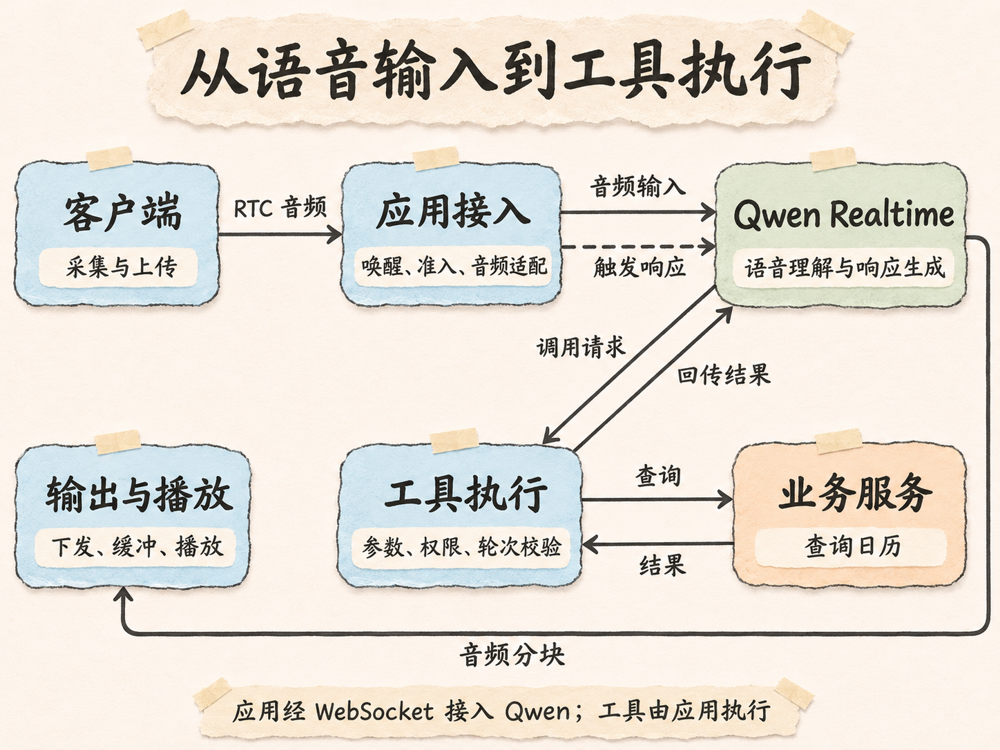
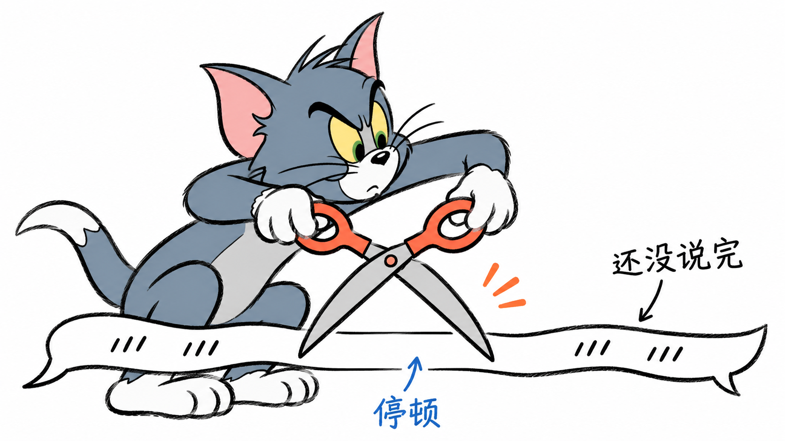
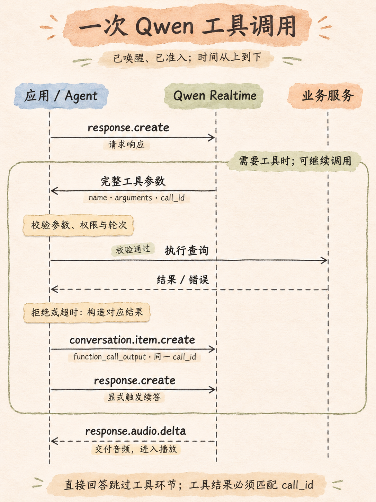

# Voice Agent 实践与落地（二）：从唤醒到多轮对话，拆解实时语音链路

上一篇讲了模型接入。连上 Realtime 以后，模型已经能听、能说。把它放进会议里，还需要处理唤醒、停顿、业务查询和用户改口，才能完成一段连续的对话。

这一篇沿着一次会议查询往下看。每个阶段解决一个具体问题，再把它们接成多轮对话。模型侧以 Mina 的 Qwen Realtime 接入为主，Pipecat、TEN、LiveKit 和豆包放在对应环节比较。

## 从一次唤醒进入两轮对话

先用一段示意对话说明我们要完成的交互。*以下会议信息为示例。*

> **用户：** 米娜，查一下今天的会议……下午最近的一场。
>
> **Mina：** 下午三点有一场项目评审。
>
> **用户：** 都有谁参加？
>
> **Mina：** 我查一下这场会议的参会名单。

这段对话需要处理以下几个环节：

1. **唤醒**：识别“米娜”，确认用户正在向助手发起请求。
2. **轮次判断**：用户说完“今天的会议”后停了一下，需要等“下午最近的一场”补充完整，再开始回答。
3. **工具调用**：根据用户给出的条件查询日历，拿到真实的会议安排。
4. **多轮衔接**：用户追问“都有谁参加”时，关联上一轮查到的会议，继续查询参会名单。

这些环节由应用和模型配合完成：

- **应用**负责接收音频、控制交互流程、执行工具。
- **模型**负责理解用户的意思、生成工具调用请求，并根据结果回答。

下面按一轮对话的处理顺序展开。实际运行时，音频采集、传输和检测会同时进行。



*虚线表示应用触发响应；实线表示音频或工具数据。*

语音接入有两种常见路线：

- **原生 Realtime**：直接向模型输入音频，并接收模型生成的音频，本文采用这条路线。
- **级联**：分别经过语音识别、文本模型和语音合成。

两种路线都能流式运行，也都需要处理下面这些交互环节。

Mina 选择 Qwen，是因为它的音频输入输出、会话控制和工具调用能力能够接入现有业务。本文对应代码默认的 `qwen3.8-omni-flash-realtime`，通过 WebSocket 接入；客户端与 Agent 之间使用 Agora 传音频。

框架可以承担其中一部分编排：

- **Pipecat** 把音频、文本和控制信号组织成 Frame，沿处理管线流转。
- **LiveKit Agents** 通过 `AgentSession` 管理输入、模型与输出。

LiveKit 的音视频传输也能单独供 Pipecat 使用，传输层与 Agent 框架可以分别选择。

## 唤醒：先确认这句话是在叫助手

会议中一直有人说话。Mina 如果对每句话都回应，很快就会打断正常讨论。唤醒的作用，就是给交互一个明确的入口。

说“米娜”是一种入口，点击语音按钮、按快捷键也是。后两种由用户直接启动；采用唤醒词时，系统需要从持续输入的声音里找到约定的名字。

常见的检测方法有两种：

- **直接检测声音里的关键词。** 这类方法叫 KWS（Keyword Spotting），使用专门的模型识别唤醒词，无需等整句话转写完成。
- **先转写，再匹配文字。** 复用已有的语音识别链路，在结果里寻找名字或短语，启动时间也会受转写速度影响。

除了检测方法，还要区分检测器运行的位置：

- **客户端检测**：可以先判断是否唤醒，再连接后端。
- **服务端检测**：声音已经经过网络传输，检测器再决定是否进入后续交互。

Mina 使用 `sherpa_onnx.KeywordSpotter`，在 Agent 所在机器上分别处理参会人的音轨。检测到“米娜”以后，才放行后面的交互音频到 Realtime。

### 唤醒时，首句往往已经开始了

用户通常会连着说“米娜，查一下今天的会议”，不会特意等系统准备好。检测器确认命中需要时间，这期间的“查一下”也必须保留下来。

Mina 按以下顺序保住首句：

1. **检测期间**，持续缓存近期音频。
2. **唤醒命中后**，补送检测期间已经说出的部分。
3. **补送完成后**，接上后续实时输入。

调试时，除了确认名字能被识别，还要检查“唤醒词 + 连续指令”是否丢字。

几个常见入口的区别可以放在一起看：

| 实现 | 如何进入交互 |
|---|---|
| Pipecat `WakePhraseUserTurnStartStrategy` | 在最终转写里匹配短语，命中后开启交互窗口 |
| LiveKit `livekit-wakeword` | 在客户端运行 ONNX 唤醒词模型，官方示例在命中后连接房间 |
| Mina | 音频经过 RTC 到达 Agent，再由关键词检测器判断是否唤醒 |
| Codex Voice | 公开文档确认按钮与配置的快捷键入口，内部检测模型未披露 |

## 会话准备：让后续输入有明确的归属

“米娜”被识别出来以后，系统要记住是谁在发起请求。否则旁边的人接了一句话，也可能被拼进“查会议”的指令里。

会话准备包含两方面工作：

- **确定交互归属**：将本次交互绑定到发言人，并保留一个有效窗口。同一人在窗口内可以继续说；换人发起请求时，再按接入规则更新归属。
- **准备模型连接**：配置音频格式、助手指令和可用工具。Qwen 通过 `session.update` 更新这些内容。

连接和工具目录可以提前准备，唤醒后再补充当前用户的业务上下文，减少首轮等待。**发言准入决定哪些声音进入对话，业务权限决定能访问哪些数据**，查询日历时仍需单独校验权限。

确定发言人、准备好模型会话后，就可以持续向模型发送音频。

## 音频输入：边说边传，避免在队列里等

一段音频从麦克风到模型，经过以下处理：

1. **采集与预处理**：客户端采集声音，按接入配置做回声消除和降噪。
2. **传输到 Agent**：通过 RTC 发送音频。
3. **适配与上传**：Agent 将音频转换成模型要求的格式，分块上传。

处理按音频块持续推进。用户还在说“下午最近的一场”时，前面的声音已经可以到达模型。

这里最容易混淆的是音频格式。RTC 的媒体编码与模型接口接受的格式可能不同，中间需要解码或重采样。Mina 当前向 Qwen 输入 16 kHz 单声道 PCM，通过 `input_audio_buffer.append` 持续发送；输出按 24 kHz PCM 处理。

让这条输入链路保持流畅，主要看两件事：

- **分块是否合适。** 音频攒得太多再发，会增加等待；块太小，则会增加消息和调度开销。
- **消费能否跟上采集。** 音频回调里如果同步等待业务查询，后面的声音就会积压。此时只改分块大小，解决不了队列堵塞。

分块是传输单位，一句话通常跨过很多个块。判断用户何时说完，需要继续观察声音本身。

## VAD：发现用户开始说话和停下来

用户说到“今天的会议”时停了一下。系统首先能观察到的是：刚才有语音，现在安静了。

VAD，也就是语音活动检测，负责发现这种变化。它持续区分语音与非语音，产生开始发声、停止发声等信号。为避免短促噪声造成反复切换，检测器通常会观察连续一段音频，再确认状态变化。

静音观察时间会影响检测结果：

- **时间短**：反应快，但容易被短暂停顿触发。
- **时间长**：边界更稳定，等待也会增加。

Mina 的 Qwen 路径使用服务端 VAD。TEN VAD 则是可以自行接入的语音活动检测组件。它们在这个阶段提供的是停声信号；用户是否已经表达完整，留给下一步判断。

## 轮次结束：给补充条件留出时间

如果系统在“今天的会议”后立刻开始查询，“下午最近的一场”就赶不上这一轮了。用户明明只说了一个请求，助手却提前回答，甚至把补充条件当成新问题。

**语音里的停顿，可能只是用户在组织后半句话。** 轮次结束检测要判断的，就是这个停顿是否意味着用户已经交出话语权。



*在停顿处过早提交这一轮，会漏掉后续补充条件。*

最直接的做法是等一个静音窗口。超过设定时长仍没有新声音，就认为这一轮结束。它容易实现，但对所有停顿采用同一标准：窗口缩短会更容易抢答，拉长又会让每次正常回答都慢一点。

为了区分这些情况，可以引入专门的轮次模型：

- **文本轮次模型**：根据转写内容判断表达是否完整，需要等待可用的转写结果。
- **音频轮次模型**：直接利用音频中的内容、语调和节奏等信号，需要音频上下文和模型推理。

| 实现 | 用什么判断 |
|---|---|
| TEN Turn Detection | 根据文本输出 `finished`、`unfinished` 或 `wait`；`wait` 对应用户明确要求等待 |
| Pipecat Smart Turn | 直接处理音频，结合内容与韵律判断是否结束 |
| LiveKit 轮次检测器 | 提供音频和文本两种路线，音频路线可用于不额外接入语音识别的 Realtime 场景 |

可以由应用接入这些检测器，也可以沿用 Realtime 服务自带的策略。**最终触发回答的责任要明确**：两边都自动触发，可能重复回应；两边依次等待，则会增加延迟。

外接轮次模型前，需要确认供应商的控制能力：

- 能否关闭内置的自动响应或轮次策略。
- 能否由应用手动提交输入、触发响应。

## 上下文与响应：把完整请求交给模型

用户终于说完了：

> 查一下今天的会议，下午最近的一场。

要处理这句话，应用需要补齐日期、时区和业务身份等背景。

这一轮交给模型的信息可以分成几部分：

- **当前请求**：用户刚说出的查询条件。
- **业务背景**：当前日期、时区和业务身份相关的上下文。
- **对话历史**：理解本轮输入时需要延续的内容。
- **工具说明**：本轮可用的工具及参数。

当前没有用到的会议历史和业务工具，可以先不加入。这样模型要处理的内容更集中，工具之间也更容易区分。

Mina 在 Qwen 路径上保留服务端 VAD，关闭自动响应和自动打断。响应由应用触发：

1. 接收检测事件，完成轮次判断。
2. 确认输入属于当前发言人，且这一轮可以回应。
3. 发送 `response.create`，请求模型生成响应。

Realtime 在接收音频时已经可以处理输入，这里说的是生成响应的触发点。接下来，模型可以直接回答，也可以提出工具调用。日历内容需要从业务系统获取，我们的例子会走向后者。

## 工具执行：把查询意图变成一次业务调用

模型知道用户要查会议，却不能凭对话猜出日历里的真实安排。应用需要先在会话中提供工具描述，例如查询最近会议需要日期、时间范围和时区。模型据此生成调用请求，应用再执行查询。

Qwen 用 `response.function_call_arguments.done` 交付完整参数。下面省略了其他元数据，工具名与参数为本文示例：

```json
{
  "type": "response.function_call_arguments.done",
  "name": "get_next_meeting",
  "call_id": "call_example",
  "arguments": "{\"date\":\"2026-11-14\",\"period\":\"afternoon\",\"timezone\":\"Asia/Shanghai\"}"
}
```

这份请求相当于模型说：“请帮我执行这个查询。”应用收到后，按顺序完成以下处理：

1. **解析参数**：检查日期、时间范围等字段是否合法。
2. **校验执行条件**：从可信业务会话取得身份与权限，并确认请求仍属于有效轮次。
3. **执行查询**：调用日历服务，获得结果或错误。
4. **准备回传**：保留调用标识 `call_id`，关联本次结果。

**模型负责提出调用，应用负责决定能否执行并完成执行。** Pipecat 和 LiveKit Agents 都提供了工具接入方式，业务权限仍需要在实际执行处落实。

示例只用一个工具就能查到会议。涉及多个工具时，按依赖关系安排执行：

- **有依赖，串行执行**：先得到会议 ID，再查这场会议的参会人。
- **无依赖，可以并行**：分别查询两个互不依赖的日历。

### 工具执行很久时，先返回明确的任务状态

查一次日历通常可以在本轮完成。对于较长的业务，Mina 会委托后台 `MeetingAgent` 执行，前台先反馈“已受理”。之后用户追问进度时，继续查询同一个任务。

应用需要保留任务 ID，并将执行状态明确返回给模型：

| 状态 | 含义与处理 |
|---|---|
| 已受理 | 任务已接收，后续通过同一个任务 ID 查询进度 |
| 已完成 | 已获得确定结果，可以向用户报告完成 |
| 失败 | 返回失败原因，供模型说明情况或安排后续处理 |
| 结果未知 | 写操作已提交但缺少可靠回执，先查询状态，再结合幂等机制决定是否重试 |

## 结果回传与续答：让模型根据查询结果回答

日历服务返回了下午三点的项目评审。查询虽然已经完成，用户还没听到答案。应用要把这条记录交回模型，模型才能把它组织成一句自然的回复。

回传结果中有两种不同用途的标识：

- **调用标识 `call_id`**：关联刚才的工具请求与这份结果。
- **会议标识 `event_id`**：标识业务中的真实会议，供后续查询参会人等操作使用。

```json
{
  "type": "conversation.item.create",
  "item": {
    "type": "function_call_output",
    "call_id": "call_example",
    "output": "{\"status\":\"ok\",\"event_id\":\"evt_example\",\"title\":\"项目评审\",\"start_at\":\"2026-11-14T15:00:00+08:00\"}"
  }
}
```

Qwen 的原生工具续答分两步完成：

1. **回传结果**：发送 `conversation.item.create`，将业务数据写回会话，并关联原 `call_id`。
2. **请求续答**：发送 `response.create`，让模型基于结果继续生成。

如果信息仍不够，模型也可能再次请求工具。



*校验通过才调用业务服务；拒绝和超时也要生成对应结果。*

### 豆包的差别在续答触发方式

Mina 接入的豆包全双工 JSON 协议，在收齐工具结果后会自动续答。应用需要在回传前准备好相关指令和状态；Qwen 则可以在回传之后、发送 `response.create` 之前完成这部分准备。

这会直接影响适配器的实现。不能只把两个服务的事件名称换一下，就认为调用链路相同。下面比较的是 Qwen Realtime 与豆包文档指定的 `session.model=1.2.6.1`，不包含豆包旧版 S2S 二进制协议。

| 环节 | Qwen Realtime | 豆包全双工 JSON 协议 |
|---|---|---|
| 完整调用参数 | `response.function_call_arguments.done` 的 `name`、`arguments`、`call_id` 描述一次调用 | 同名事件中的 `items` 可包含多个调用，各有 `call_id` |
| 结果格式 | `conversation.item.create` 中使用 `item.type=function_call_output`，结果放在 `output` 字符串里 | 同名事件使用 `items`，每项包含 `role=tool`、`call_id` 和 `content` |
| 续答 | 回传后显式发送 `response.create` | 聚合该批工具结果回传后自动续答 |

豆包要分别处理这一批中的各个调用，拒绝或失败也应返回对应结果，避免一直等不到某一项。Qwen 单个事件描述一次调用，同样可能在一轮里产生多个工具调用。

自动响应的差异也出现在首轮。豆包服务端会自行生成回复，Mina 的适配器需要控制这些事件的交付：

1. 暂存尚未通过发言准入检查的模型事件。
2. 通过检查后，放行并交付这些事件。
3. 若事件涉及工具调用，在执行前再次检查轮次是否有效。

应用等待放行的时间，要和模型生成时间分开观察。

## 流式播放：让用户尽早听到答案

模型开始回答“下午三点有一场项目评审”时，音频会分块返回。应用收到一部分，就可以将它送进播放链路，让生成与播放同时进行。

```text
模型音频分块 → 应用输出队列 → 格式适配与发送 → 客户端缓冲 → 播放
```

播放缓冲需要在等待时间与声音连续性之间取舍：

- **等整段生成完再播放**：用户会多等后半段音频的生成时间。
- **完全不留缓冲**：网络稍有抖动，声音就可能断续。

采用流式播放时，可以边生成边交付，并按实际网络状况保留适量缓冲。

Qwen 的音频事件是 `response.audio.delta`，本文使用的豆包协议则是 `response.output_audio.delta`。适配层将它们转换成后续输出链路能处理的音频，客户端再按播放节奏消费。

Mina 也保留了独立的语音合成分支，用于部分控制反馈、受理反馈和已经确定的结果。这些文本可以直接合成为语音，无需让 Qwen 再改写一次。

**听到反馈与拿到结果，是两个不同的时间点。** “我查一下”让用户知道请求已被接收，“下午三点有项目评审”才提供查询结果。后面的耗时分析会分别记录首声和有效回答。

## 打断：接收改口，同时停下旧回答

现在给示例增加一种情况：Mina 刚开始播报，用户插入一句：

> 等等，只看我主持的。

查询条件变了，旧回答已经不再适用。

系统需要在播放期间继续接收输入，并判断这次发声是否应当打断。VAD 可以提供发声信号，再结合发言人、词数或专门策略过滤回声、旁人的讨论和简单附和。

确认接受这次打断后，几个动作要配合进行：

- **停止播放**：清理应用和客户端中尚未播放的旧音频。
- **停止旧生成**：取消生成，或停止交付它后续产生的内容。
- **使旧轮次失效**：过滤晚到的音频与工具结果。
- **处理业务任务**：根据执行状态决定后续处理。

这些动作可以并行发起。尤其不能等工具取消成功，才让客户端停止播报；有些业务请求本来就无法立即取消。

### 停止播放之后，旧结果仍可能到达

假设日历查询已经发出，用户这时改口，旧查询仍可能正常返回。应用要将结果关联到原轮次，避免它混入新的回答。这也是轮次标识的作用：帮助应用判断一份结果是否还适合交给用户。

如果工具执行的是写入，情况还要更谨慎。**停止播报不等于撤销已提交的业务操作。** 已提交的请求仍需收取回执，或查询最终状态。

对话历史也应尽量与实际播放进度一致。用户只听到半句话，后续就不能默认整段内容已经传达；具体能否截断模型中的历史，要看供应商接口和适配实现。

接受的新条件随后进入下一轮，沿输入、轮次判断和工具调用继续处理。

## 多轮对话：让“谁参加”接上刚才那场会议

回到正常完成第一轮的情况。用户听完会议时间，接着追问：

> **Mina：** 下午三点有一场项目评审。
>
> **用户：** 都有谁参加？

第二句话省略了会议名称，却并不难理解，因为对话已经确定了对象。应用保留上一轮返回的 `evt_example`，模型就可以基于这场会议继续请求参会名单，无需重新查一遍“今天的会议”。如果前面仍有多场候选，则需要先澄清指代。


*会议 ID 让追问落到具体对象，对话历史帮助模型理解省略的条件。*

除了理解追问，系统还要管理收听状态，让用户不用每说一句都重新喊“米娜”。Mina 的交互窗口按以下规则运行：

- **窗口有效时**：同一发言人可以直接继续输入。
- **思考和播报期间**：`ConversationState` 暂停静默计时，避免查询或回复尚未结束就退出交互。
- **回到收听后**：重新开始计时，超时后再回到等待唤醒。

到这里，持续对话实际依赖三类状态：

| 状态 | 负责保留什么 |
|---|---|
| 交互状态 | 当前发言人，以及还能否直接继续说话 |
| 对话上下文 | 已确定的会议、查询条件与必要的历史回复 |
| 业务任务状态 | 后台任务的进度和执行结果 |

这三类状态分别管理：

- **交互窗口过期**：结束免唤醒收听。
- **后台任务仍在执行**：继续跟踪进度和结果。
- **上下文变长**：保留当前对象、必要工具回执和近期对话，再压缩较远历史。

这样，第二轮复用了第一轮建立的上下文与连接，新的声音仍然经过相同的输入、判断、调用和播放过程。

## 可观测性：把“回答慢”定位到具体阶段

沿着这次查询看下来，用户的等待可能发生在收句、工具执行，也可能发生在结果已经返回之后。只记录一个总耗时，很难决定先优化哪里。

### 先分清用户在等什么

从本轮用户语音结束开始，可以观察三个不同的终点：

| 指标 | 到什么时候结束 | 示例 |
|---|---|---|
| 首声延迟 | 首段反馈开始播放 | “我查一下” |
| 有效回答延迟 | 包含结果的回答开始播放 | “下午三点有一场项目评审” |
| 任务完成延迟 | 业务获得确定执行结果 | 日历查询成功返回 |

任务可能先完成，模型随后才播报；也可能先播放受理反馈，业务在后台继续运行。因此这三个指标需要分别统计。首次唤醒和会话准备另外记录，才能覆盖说出指令之前的启动成本。

### 沿一轮请求记录时间点

以应用控制响应的 Qwen 路径为例，可以在下面这些边界埋点。它们是建议的测量口径，并非框架内置指标名。

| 区间 | 起点 → 终点 |
|---|---|
| 轮次等待 | 用户语音结束 → 应用确认轮次结束 |
| 响应准备 | 轮次确认 → 发出响应请求 |
| 工具决策 | 响应请求 → 完整工具参数就绪 |
| 工具调度 | 参数就绪 → 工具处理函数开始执行 |
| 工具执行 | 开始执行 → 产生结果 |
| 结果回传 | 产生结果 → 发送完成 |
| 结果续答 | 结果发送完成 → 首块结果音频到达 |
| 播放准备 | 首块结果音频到达应用 → 客户端开始播放 |

例如，Mina 的自定义适配会收齐完整响应后再执行工具，所以参数就绪与实际执行之间还存在调度等待。再如，应用拿到音频后，客户端可能还在缓冲。把这些边界分开，才能解释“查询很快，听到答案却很慢”。

不同接入方式可以利用不同的埋点位置：

- **LiveKit**：会话 trace 已覆盖轮次等待、工具执行和实时推理等阶段。
- **Pipecat 自定义适配**：在处理节点、模型事件和工具函数处补点。
- **豆包自动响应路径**：使用实际可观察的服务端事件，另记应用放行等待，不套用 Qwen 的手动触发边界。

### Grafana 中保留四组视图

- **整体等待**：首声、有效回答的 P50/P95 与失败率，区分直接回答、工具调用、冷启动和独立语音合成。
- **阶段耗时**：查看收句、工具、续答和播放准备的分布，找到最值得继续检查的一段。
- **交互质量**：结合标注或抽检，观察误唤醒、漏唤醒、首句丢失、抢答和误打断。
- **单次请求追踪**：将一轮里的输入、调用和输出串起来，解释具体一次等待。

指标分组与单次请求关联使用不同的信息：

- **指标标签**：模型、工具和响应路径，用于汇总比较。
- **日志或 trace 字段**：会话 ID、轮次 ID、`call_id` 和任务 ID，用于定位具体请求，避免指标标签数量无限增长。

测量时有几个会影响结论的前提，需要统一处理：

- **停声起点**：服务端的 `speech_stopped` 已包含传输与检测等待，不能直接当成客户端实际停声时刻。
- **播放终点与时钟**：要确认用户何时听见，需要客户端播放回执和跨端时钟校准；缺少回执时，只报告已观察到的服务端边界。
- **统计口径**：各阶段 P95 不能相加。并行与重叠阶段应回到同一次请求，沿实际关键路径分析。

有了这些数据，就能将现象对应到排查方向：

| 现象 | 优先检查 |
|---|---|
| 轮次等待高 | 静音窗口、语义检测和最终转写依赖 |
| 工具很快返回，有效回答仍慢 | 结果回传、续答和播放 |

调整后用同一组请求复测，同时抽检是否更容易抢答、漏条件或误打断，确认缩短等待后仍能完整处理用户请求。

## 参考资料

- [Qwen Realtime：实时多模态](https://help.aliyun.com/zh/model-studio/omni-realtime-api)
- [Qwen Function Calling](https://docs.modelstudio.console.alibabacloud.com/en/model-studio/qwen-function-calling)
- [Pipecat Frames](https://github.com/pipecat-ai/docs/blob/main/api-reference/server/frames/overview.mdx)
- [Pipecat LiveKit Transport](https://docs.pipecat.ai/api-reference/server/services/transport/livekit)
- [Pipecat LLM Service 与工具调用接口](https://reference-server.pipecat.ai/en/stable/api/pipecat.services.llm_service.html)
- [LiveKit AgentSession](https://docs.livekit.io/agents/logic/sessions/)
- [LiveKit Realtime Models](https://docs.livekit.io/agents/models/realtime/)
- [LiveKit Turn Detection](https://docs.livekit.io/agents/logic/turns/)
- [Pipecat User Turn Strategies](https://docs.pipecat.ai/api-reference/server/utilities/turn-management/user-turn-strategies)
- [Pipecat Smart Turn](https://github.com/pipecat-ai/smart-turn)
- [TEN Turn Detection](https://github.com/TEN-framework/ten-turn-detection)
- [LiveKit Wakeword Detection](https://docs.livekit.io/agents/multimodality/audio/wakeword/)
- [LiveKit 音频与文本轮次模型](https://docs.livekit.io/agents/logic/turns/turn-detector/)
- [Codex Voice 使用说明](https://help.openai.com/en/articles/20001275-chatgpt-work-and-codex)
- [LiveKit Session Traces and Metrics](https://docs.livekit.io/reference/agents/session-traces/)
- [火山引擎全双工接入与工具调用](https://docs.volcengine.com/docs/doubao-voice/access-must-read?lang=zh)

## 摘要与标签

以两轮会议查询为例，逐阶段讲解唤醒、音频输入、轮次判断、工具执行、续答、播放和打断，并说明多轮上下文与延迟观测。

建议标签：Voice Agent、Qwen、Pipecat、LiveKit、可观测性。

## 附录：配图制作记录

*以下为编辑材料，不属于发布正文。*

本稿采用 practical-tech-writing `7671ad9`。结构图使用 baoyu-infographic / craft-handmade，正文隐喻图使用 Visual IP 的 Tom 路线。图片均通过内置 imagegen 生成，保留原始位图与完整提示词；旧 SVG 只作历史资产保存，正文不再引用。

- [配图分析与版本记录](assets/voice-agent-02-realtime-pipeline/analysis.md)
- [结构说明](assets/voice-agent-02-realtime-pipeline/structured-content.md)
- [接入链路图提示词](assets/voice-agent-02-realtime-pipeline/prompts/01-pipeline-craft.md)
- [停顿与轮次插图提示词](assets/voice-agent-02-realtime-pipeline-tom/prompts/02-pause-is-not-end-tom.md)
- [工具时序图提示词](assets/voice-agent-02-realtime-pipeline/prompts/03-tool-sequence-craft.md)
- [多轮上下文插图提示词](assets/voice-agent-02-realtime-pipeline-tom/prompts/04-followup-context-tom.md)

Tom 路由的维护状态为 `gated-authorized`，来源与边界依 visual-ip-illustrations 的 `references/ips/tom/rights.md` 记录；该状态不表示版权方授权，本次未向上游样例目录发布图片。
