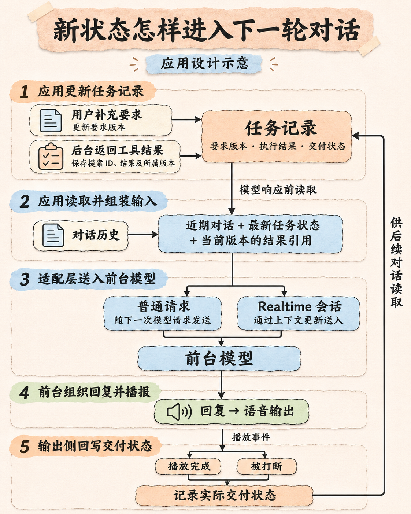

# Voice Agent 实践与落地（三）：前后台分离与记忆管理

“生成检查任务。”创建请求已经发出，用户又说了一句：“截止时间改成明天下午五点。”我们在 Mina 的测试里故意扣住了第一次调用的回执。这个时候，助手已经听懂了第二句话，却还不知道该改哪一份提案。

第一版 Mina 把工具调用和 Agent loop 都放在语音交互侧（前台）。比如整理会议行动项，模型先读转写，再从里面找负责人，最后调用工具创建提案。用户说完一句话，要等这几步跑完才听得到答复。要是用户中途改了主意，麦克风能收到第二句话，已经发出的模型请求里却只有第一句。

拆开这两件事的想法来自 Codex。我们读它的语音实现，发现新说的一句话还能送进已经启动的执行轮次。那段时间 Pipecat 也在 1.13.0 加入了前后台委托组件。Mina 本来就有处理会议的业务 Agent，我们决定让它作为业务执行侧（后台）接手工具循环，语音交互侧就能继续听用户讲话。

## 交互侧究竟在等什么？

拿读会议转写举例。如果语音模型调用的工具里写了 `await run_agent(...)`，等数据库返回的这段时间，事件循环照样能收音频。卡住的是模型发起的这次工具调用：它要拿到返回值，才能回答用户。哪怕把查询改成异步 I/O，这个先后顺序也没变。

我们把工具的返回时机往前挪。收到委托，先核对发言人能访问哪场会议，把用户原话、会议标识和相关的前文交给独立运行的任务。任务一受理，委托工具就返回，语音模型这时有依据说“我来整理”。执行侧继续读转写、挑行动项，最后把提案交回来。

这两部分可以在同一个进程里运行。碰到单纯耗时的查询，一个异步任务就够了。整理提案用到执行侧模型，是因为读过转写才能决定接下来调哪个工具。

## 第二句话送到哪里

假设用户在整理期间开口。听起来都和同一场会议有关，处理起来却是三件事。

- **“做到哪了？”** 交互侧按任务标识读最新进度。如果执行侧刚开始读转写，照实回答就行，没必要再读一遍。
- **“由小陈跟进。”** 如果执行侧刚问过“这项工作由谁负责”，这句话就是问题的答案。交互侧把它送回那次提问，等答案的任务接着往下跑。
- **“只整理发布相关的。”** 这句话改了提案的范围。交互侧要找到刚才那项任务，执行侧要在下一次挑选行动项之前读到新条件。

最后一种最容易漏。假如读转写的请求已经发出去，改任务表里的“范围”不会改变模型刚才发出的调用。执行器得给它一个重新看要求的机会。支持追加输入的执行器，会在工具返回后把转写和补充要求一起送给模型。另一种做法是停下旧计划，带上原始要求、新条件和已经执行过的操作，重新规划。

这就引出了**要求版本**。把“整理全部行动项”记作 v1，收窄到“只整理发布相关的”后升到 v2。两次执行共用一个任务标识，但只有 v2 的结果能进入播报队列。即使 v1 晚一步交回完整清单，交互侧也知道那份清单已经过期。

如果用户接着改成“只要客户端发布”，可以把尚未提交的范围修改合并，让执行器直接读最新版本。已经发出的写入仍逐笔收回执。最新版本执行失败，就报告这次失败，保留已创建的提案，别让 v1 的成功提示重新排进队列。“另外给后端也建一份”则换了目标，应另起任务，保留原提案。

### 创建请求已经发出，还能怎么改？

回到开头的测试。用户要改截止时间，创建工具却还没交回提案 ID。直接取消旧协程再跑一遍“生成检查任务”，有可能生成两份提案。业务服务可能已经建好了提案，只是回执还在路上。取消本地协程，撤不回那次写入。

这里有两件事值得分开等。**交互侧接到修改就能回应，执行侧要等创建回执才能动手改。** 交互侧先记下“明天下午五点”，把要求升到 v2，撤下旧的待播报内容。等回执的仍然是执行侧。回执一到，里面有刚创建的提案 ID 和业务版本。执行侧按 ID 重新读提案，拿当前业务版本提交修改。这样既能接上自己刚才的写入，也能发现其间别人改过这份提案。

两个版本号各管一件事。**要求版本**决定哪一次执行还有资格跟用户说“办好了”。**提案版本**决定这次修改依据的业务记录是否仍然有效。即使旧执行已经失去播报资格，它带回来的创建回执仍然有用。

*图 1　顺着 p1 看，v1 的创建回执决定了 v2 要改哪一份提案。*

### 回执丢了，拿什么找到提案？

提案 ID 得等服务端返回，**操作 ID 在请求发出前就有了**。Mina 给真实发言里的每笔写操作分配稳定的 `operation_id`，通过 MCP 请求头传给 Java。重发同一次创建沿用原键。用户后来要求改截止时间，那是另一笔写入，有自己的键。

Java 用租户、会议、发起人和创建操作 ID 推导提案 ID。保存修改时，提案和命令回执在同一笔数据库事务里提交。回执按租户、会议、提案、操作者和请求 ID 唯一定位，还存一份请求摘要。同一键、同一内容重放，就返回原回执。同一键却换了内容，服务端报冲突。即使两次提交撞在一起，唯一约束也守得住同一份提案。

这给超时恢复留了入口。Mina 的持久作业已有 `lookup_background_submission`，能拿原操作 ID 查是否受理。提案执行遇到结果未知，目前会停下自动重跑。要给提案接上自动恢复，调用方得在发送前持久保存操作 ID 和原请求，在原权限范围内按键查回执，或向支持幂等的接口原样重放。一次查询为空也可能是首笔事务尚未提交，此时仍要复用原键。标题相同的提案可能有好几份，不能拿标题对账。

用户说“算了”，执行侧先停后续步骤，再按回执决定怎么收尾。提案能撤销，就把补偿单独记作“待撤销”，直到撤销接口确认成功再改为“已撤销”。已送达的邮件收不回来，应明确告诉用户“邮件已经发出”。日历取消通知、纠正邮件或补偿 webhook 都是新的业务操作，各自有权限、操作 ID 和回执。

## “先别说了”以后，下一轮记住什么

工具返回提案 ID，执行侧记下“提案已创建”。过一会儿用户打断播报，交互侧记下“本次播报被打断”。这两条记录都是真的。把开头那次调用按事件排开，就能看出每条状态该由谁改。

| 事件顺序 | 执行与交付的变化 | 用户此刻能听到什么 |
| --- | --- | --- |
| v1 已发出创建请求 | 创建在途，提案 ID 未知 | 可以确认已受理 |
| 用户提交 v2 | 要求版本升到 2，停止 v1 的后续步骤，旧播报失效 | 已收到新的截止时间 |
| v1 创建回执到达 | 保存提案 ID，供 v2 读取并修改 | 暂不播报旧结果 |
| v2 修改成功 | 执行完成，结果等待播报 | 等用户说完，再播报修改结果 |
| 播报中途被打断，完成回调随后到达 | 这次播报终止于“被打断”，提案仍已修改 | 停止后续音频，重播沿用原结果 |

**完成和打断撞在一起，谁先把同一次播报推进终态，谁生效。** 如果完整音频已经送完，再来一条打断，只影响此后的声音。如果打断先到，晚到的完成回调就丢弃。要求升到 v2 后，v1 的任何回调都无权改写 v2。曾经播完的 v1 仍属于历史，已经送到扬声器的声音也收不回来。

落到状态机上，每一版任务从受理进入执行，成功、失败或取消后结束；写入结果未知就暂停，核实回执后再决定后续动作。播报单独从等待、排队进入播放，完成或打断后结束。每次播报还要有自己的标识（utterance epoch 或队列句柄），重播同一版本也另开一次。改口或打断要取消合成、清理可控的发送队列，发送端逐块核对标识，拦住已经排队的旧音频。若终端还有独立缓冲，也要把停止信号送到终端。分布式实现可按任务串行写事件日志，用事件 ID 去重，按版本、播报标识和前一状态提交变更。这样重放完成回调也改不了终态。

*图 2　语音输出把“播报被打断”写回任务记录，下一轮仍能沿用已创建的提案。*

要是下一句问“刚才那份提案是谁负责的”，交互侧模型得先知道“刚才那份”指哪个 ID。交互侧拿近期对话和提案引用来确定用户在问哪一份，再按 ID 去业务服务查当前负责人。把播报状态也带上，它就知道上次说到一半被打断过。整场转写、每步推理用过的材料仍留在执行侧。普通模型请求直接带入这些信息，持续连接的 Realtime 模型则要在处理新输入前同步会话上下文。

这里的“已交付”有个很实际的限度。Mina 能确认完整音频已经发出。用户摘下耳机，发送端看到的事件照旧。因此，哪怕已经记作“已交付”，用户说“再讲一遍”，也该沿用原结果重播。

## Codex、Pipecat 和 LiveKit 各自管到哪一步

同一句“改一下”，三个项目提供的入口不同。

| 实现 | 第二句话怎样进入执行 | 进度和结果怎样回来 |
| --- | --- | --- |
| Codex Realtime | `StartOrSteer` 在空闲时启动轮次，有可继续的活动轮次就向它追加输入 | Realtime V2 用 `handoff_id` 匹配此次语音 handoff 的回报，完成后请求语音响应 |
| Pipecat 的 `LLMWithBackend`（1.13.0 引入时为 alpha） | 交互侧再次调用 `delegate`，执行侧结合自己的工具和上下文判断该继续、修改还是取消 | 进度静默进入交互侧上下文，执行侧的问题和最终结果由交互侧转述 |
| LiveKit 的子代理示例 | Talker 调用 `analyze(question)`，Reasoner 用独立上下文分析。若要把后来的修改送进同一任务，关联逻辑由应用补上 | 异步工具首次 `await ctx.update(...)` 后对话继续，工具用 `return` 交回最终结果 |

*图 3　请求协调层把新发言和工具回执关联到同一项任务。*

Codex 把追加输入接进运行中的轮次，Pipecat 封装了两个模型间的消息传递。LiveKit 示例交付的是异步工具调用，第二句话属于哪项任务、能否改动那项任务，由接入方决定。三种做法落到多人会议里，都要回答同一个权限问题：换一个人说“改一下”，谁来决定这句话算数？

## Mina 最后怎么接

我们用 Pipecat 跑语音管线，沿用已有的会议 Agent 处理业务。`MeetingVoiceRuntime` 把说话人的身份和原话一起交给 `MeetingRequests`，同一请求上核对发起人。Java 提案服务还会检查租户、会议成员资格和具体操作权限。例如，经会议权限检查，外部成员仍不能管理提案；内部成员中，主持角色或指定确认人才能执行相应的管理动作。具体哪次写入获准，由服务端核定。

会议转写走的是资料通道。哪怕里面有人说“把这份提案发给外部邮箱”，读转写的工具也只是在返回一段原话。接入外发能力时，我会把边界放在工具入口：

- 按操作者、租户、会议和工具 scope 生成可调用的白名单，执行前重新授权。转写里的姓名、角色或指令都不能替发言人授权。
- 对外发送前，向有权限的人确认收件人和内容，把确认绑定到该版本。收件人换了，就重新确认。
- 审计只记核查所需的操作者、目标、操作 ID、确认依据和结果。一次外发为什么获准，应当查业务记录就能说明白。

开头那个测试把执行侧的工具调用顺序固定了下来。

1. **创建**。让创建工具先收到请求，扣住回执，再提交“截止时间改成明天下午五点”。`_amend()` 此时已经返回 `amending`，要求版本到了 2。测试检查此刻只调过一次业务工具。
2. **读取**。放行回执，执行侧的 `_replace()` 拿到提案 `p1` 的引用，连同新要求交给下一次执行。新计划先读 `p1`。
3. **修改**。最后一次调用仍指向 `p1`，带上业务版本 7 和新的截止时间。到这里，测试才断言任务完成。

执行侧反过来请人补充信息，走的是另一条入口。`ask_meeting_user` 把问题编号和要求版本登记在请求上。等媒体层确认问题的音频完整发出，Mina 才开始接收这道题的答案。中间如果改了要求，旧问题随旧版本一起失效。

### 会话里怎样同步，散会后还剩什么

Mina 每轮用 `frontend_messages()` 把当前任务快照放进 `meeting_voice_state`。媒体层在合成期间逐块检查版本。发送结束后，只有播报对象、排空标记和音频字节数都对得上，才调用 `mark_delivered()`。打断会清掉当前回执对象，`output_current()` 也会拒绝已标为 `interrupted` 的播报。下一轮模型读到的是更新后的状态。对话历史只给已播完的执行侧结果留一个引用，详细工具回执留给执行侧。

共享 Realtime 连接还有一处取舍。一次工具调用尚在续跑，中途替换上下文会打乱这次交互，所以我们把同步推迟到续调用结束。开启共享历史后，完整的原生回复结束，适配层会用本地保留的历史重建连接。新连接要重新握手、装载上下文，旧连接上未完成的模型轮次也不能假定还在。我们的豆包独立网关探针有过一次 **359 ms** 的握手记录（合成语音、未入会、未加载业务工具）。这只量到了建连。要量用户实际多等了多久，应在同一模型、网络和上下文长度下，对照复用与重建连接的“用户说完到首段音频”P50、P95。恢复时用已确认的消息和结果引用重建上下文，按发言与工具操作 ID 去重，旧连接迟到的回调按连接代次丢弃。

会议一长，`MeetingHistory` 会压缩早期对话。生成摘要的工夫里，参会者可能又说了几句，所以写回前只替换送去压缩的那段原文，保留后来追加的消息。如果原片段也被改过，就丢掉这次摘要。有人追问“当时原话怎么说”，再用 `read_meeting_transcript` 查原始转写。

| 散会后想找回什么 | Mina 存在哪里 | 实际能恢复什么 |
| --- | --- | --- |
| 对话、摘要、活动请求、播报进度 | Python 会话内存 | 同一场助手会话内重建语音连接，仍可沿用。关闭会话后清理 |
| 会议转写、资料、提案 | 各自的业务服务 | 按权限重读原文，或凭提案 ID 找回业务记录 |
| 已受理的持久作业 | Java 服务的 PostgreSQL 作业记录 | 依照作业自身的状态继续执行 |

语音重连时 Python 进程还在；发布重启或进程崩溃，会一起丢掉内存中的执行和播报位置。这是当前实现的恢复边界。要跨重启续办，可以在写入发出前保存任务检查点，记录任务归属、最新要求版本、操作 ID 和在途状态，再随业务回执和待播报结果增量更新。恢复先核对当前权限，再用操作 ID 对账。上次播报停在哪儿无法确认，就让用户决定是否重播。跨会议偏好另外征得同意、单独保存。

### 故障怎么复现

给一次交互分配 `trace_id`，让发言、任务、工具和播报的事件都带上它。一个任务跨了几轮对话，就用任务 ID 把各轮 trace 关联起来。线上分别数**丢弃的过期结果、命中的重复写入、结果未知的写入**，排查时再按任务查那几笔操作。任务 ID 这类高基数字段留在事件里。

跑自动化时，我会在三个位置动手，而不只听最终答复：

1. **业务已提交，扣住回执。** 重复投递同一次创建，断言只有一份提案；同键改参数应报冲突。随后杀进程，用检查点恢复，再数一次业务记录。
2. **连续修改，倒序返回。** 依次提交 v2、v3，让 v1 最晚完成、v3 失败。检查旧回执还在，旧的成功提示没有进播放队列。
3. **发到半句，先打断再交完成回调。** 检查剩余可控音频已停，交付终态仍是“被打断”。交换两个事件的顺序，已完整发送的播报应保留“已交付”。

## 最小实现清单

- **写入可核实**：调用方保存 `operation_id`，业务侧用幂等唯一约束和回执处理重放。
- **修改有归属**：要求版本筛选可播报的结果，业务版本保护提案的并发修改。
- **音频能停住**：执行和交付各有状态机，每次播报有独立 epoch 或队列句柄。
- **事后查得清**：工具入口执行授权，事件日志用 `trace_id` 串起发言、写入和播报。

## 参考资料

- 看一次新输入如何启动或追加到执行轮次。[Codex 输入路由源码](https://github.com/openai/codex/blob/65a5410f72dac1f4b40862c34ef0a8b71b12834a/codex-rs/core/src/session/turn_input.rs#L911)
- 核对 Realtime 委托如何按 ID 匹配结果、触发回复。[Codex 结果回传源码](https://github.com/openai/codex/blob/65a5410f72dac1f4b40862c34ef0a8b71b12834a/codex-rs/core/src/realtime_conversation.rs#L2778)
- 核对 Pipecat 引入前后台组件时标注的 alpha 状态。[Pipecat 1.13.0 发布记录](https://github.com/pipecat-ai/pipecat/releases/tag/v1.13.0)
- 查看交互侧二次委托，以及进度和待播报结果各走哪条路。[Pipecat 后台模型指南](https://docs.pipecat.ai/pipecat/learn/llm-with-backend)
- 核对第一次进度更新如何放开当前对话。[LiveKit 异步工具文档](https://docs.livekit.io/agents/logic/tools/async/)
- 查看 Talker 怎样委托分析、Reasoner 实际收到了哪些上下文。[LiveKit 子代理示例](https://docs.livekit.io/agents/logic/patterns/subagent-delegation/)
