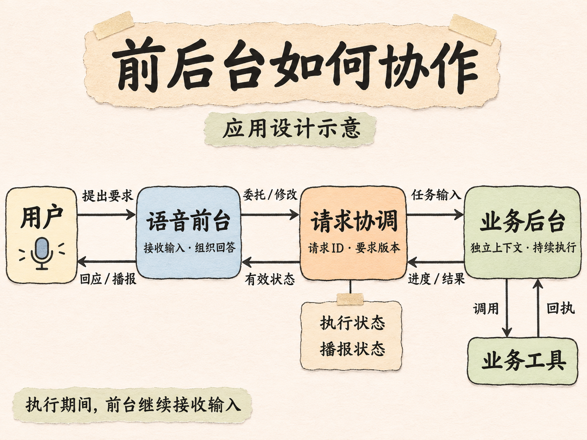

# Voice Agent 实践与落地（三）：前后台分离与记忆管理

“生成检查任务。”Mina 刚把创建请求发出去，用户接着说：“截止时间改成明天下午五点。”我们在测试里故意扣住创建工具的回执，看看这时候 Mina 能做什么。它已经收到了新的截止时间，手里却还没有提案 ID。

## 创建请求发出以后，谁还在听？

第一版 Mina 把 Agent loop 和工具调用都放在语音交互侧。语音模型调工具，工具里 `await run_agent(...)`，等会议 Agent 把事办完再返回。等数据库的这段时间，事件循环照样能收音频。但语音模型还在等第一次工具调用结束，用户后说的那句“改成明天下午五点”，也进不了已经发出去的模型请求。

读 Codex 的语音实现时，我们注意到它给运行中的任务留了一个接收新输入的入口。当时 Pipecat 也推出了前后台委托组件。Mina 已经有一个会读会议资料、创建提案的业务 Agent，我们就把工具循环交还给它。语音交互侧核对发言人和会议，把原话交给这个独立运行的执行侧。委托一受理，工具就能返回，Mina 可以先说“我来建”，继续听用户讲话。

*图 1　语音轮次等到委托受理就能往下走，创建提案的工具仍在执行。*

这样，创建提案花了多久，就不再决定用户要等多久才听到受理答复。两侧可以在同一进程里运行。一次慢查询交给异步工具就够了；读完会议转写还要选工具、确定下一步，才值得给执行侧单独留一个模型上下文。

## 接到“改成明天下午五点”

测试直接把发言文本交给请求管理器。真在会议里听到这句话，语音入口还得处理两件事。首先是轮次：用户说到“明天下午”停了一下，语音活动检测能发现静音，还有“五点”没说出口，过早断句会漏掉小时。其次是话说给谁：参会者可能在提醒同事。要结合当前交互和发言人决定是否接话。如果关键时间仍有歧义，应该先请对方确认，免得把听错的时间写进提案。

听清以后，先看这项任务有没有刚刚问过、还等着回答的问题。同一句“五点”，落在不同位置，执行侧要做的事也会变。

- Mina 刚问过“什么时候截止？”，回答“五点”就送回这次提问。`ask_meeting_user` 为问题登记编号，媒体层确认问题完整发出后才接受回答。
- 用户问“做到哪了？”，查受理时分配的任务 ID 即可。进度测试里，返回的 ID 和最初受理时相同，状态仍是 `running`。查询找到了正在跑的那项工作。
- 开头那句“截止时间改成明天下午五点”说得很明确，用户要改正在创建的检查提案。交互侧要把新条件送回同一项任务。“另外再建一份”才另起任务。

确定意图之后还要核对权限。`MeetingVoiceRuntime` 把发言人身份和原话交给请求管理器，核对任务归属。业务服务再检查租户、会议成员资格和提案管理权限。会议转写只是执行侧读到的资料，里面记载的指令无法替当前发言人授权。涉及对外发送等操作，工具还得校验权限，向有权的人确认内容和收件人，并留下审计记录。

## 修改先受理，写入等回执

交互侧现在能回答“收到，改成明天下午五点”。如果第一轮准备好的“已经办好了”随后也播出来，用户会以为新的截止时间已经写进去了。为此，Mina 在同一个任务上记**要求版本**：最初创建是 v1，收到修改后升到 v2。代码在受理修改时把旧播报标为 `superseded`，供输出侧据此拦截。

这里可以看测试里的两条断言。创建工具仍卡在等待回执的位置，修改入口已经返回 `amending`，要求版本为 2。此时业务工具调用总数仍是 **1**。也就是说，交互侧已经接住了修改，执行侧还没有发出第二笔写入。

**为什么还要等一个已经过期的版本？** 因为业务服务可能已经创建了提案。取消本地协程撤不回那笔写入。如果拿新要求从创建这一步再跑一次，就可能多建一份。

放行回执，事情才有了落点。开头的测试用 `p1` 代表刚建好的提案，回执里的业务版本是 7。Mina 保留这份回执，把新要求交给下一次执行。测试最后核对了实际调用顺序：

1. 创建检查任务的提案，回执返回 `p1`。
2. 读取 `p1` 的当前内容。
3. 修改同一个 `p1`，带上 `expectedRevision=7` 和“明天下午五点”。

这里的 **7 是业务版本**。假如读取后有人抢先编辑了提案，服务端就能拒绝基于旧记录的修改。向用户播报前则要核对任务的当前要求版本。这次是 v2，用户再次改口还会再升。两个版本各自挡住了一种错误。要是 v2 修改失败，就报告失败，不能拿 v1 创建成功的消息来顶替。

测试里的回执只是晚到。如果它丢了，执行侧连 `p1` 都没见过，拿什么去查？这才用到**操作 ID**（`operation_id`）。它在请求发出前就生成，重发同一笔创建沿用原键，服务端凭它找到已有回执。后来修改截止时间有自己的键，两笔写入不会混在一起。

Mina 遇到提案写入结果未知，会停下自动重跑。持久作业单独提供了按操作 ID 查询受理结果的入口。回执怎样和业务写入一同提交，见[第四篇《工具调用超时，怎样重试才不会重复写入？》](/posts/voice-agent-practice-04-write-once)。

## 截止时间改好了，播报被打断呢？

修改成功，只能说明 `p1` 的截止时间已经更新。用户可能还在讲话，结果得先等着。Mina 有个独立的播报测试：业务任务先完成，用户仍在说话，待播队列为空；输入处理结束，队列里才有一条结果。随后叫停播报，这条结果失去播放许可，测试检查业务任务依然是 `completed`。

这就是一次修改留下的两份记录。执行侧记“提案已改”，输出侧记“这次播报送完了”或“中途被打断”。用户说“先别说了”，只停声音。说“算了，不改了”，才涉及业务动作；若修改已经落库，撤销还得另走业务接口。

为了挡住排队里的旧声音，Mina 把一次播报绑定到任务及其要求版本，合成和发送音频时都检查它是否仍然有效。音频测试在第一块 PCM 送出后调高版本，断言传输端只收到这一块，旧播报也没有被标记为 `delivered`。已送出去的声音收不回来；发送完成也只能证明音频送完，用户有没有听清还得由对方判断。

*图 2　业务回执告诉 Mina 改了哪份提案，播放事件告诉它刚才那句话有没有完整发出。*

## 框架把第二句话送到哪一步

再拿“改截止时间”看当时调研的三种实现。这里只比较两端的消息传递：新要求从哪里进去，执行结果从哪里回来。

| 实现 | 补充要求从哪里进去 | 结果从哪里回来 |
| --- | --- | --- |
| Codex Realtime | `StartOrSteer` 在空闲时启动轮次，有支持追加输入的活动轮次就继续送入 | Realtime V2 按 `handoff_id` 匹配这次语音委托的回报，再请求语音响应 |
| Pipecat 的 `LLMWithBackend` | 交互侧再次调用 `delegate`，执行侧结合已有上下文判断怎样修改（1.13.0 引入时为 alpha） | 进度静默进入交互侧上下文，需要回答的问题和最终结果由交互侧转述 |
| LiveKit 子代理示例 | Talker 调用 `analyze(question)`。后一句要修改哪项工作，由接入方关联 | 工具首次 `await ctx.update(...)` 后对话继续，最终通过 `return` 交回结果 |

Mina 还得决定业务写入由谁收尾。我们沿用 Pipecat 语音管线，把请求管理留在应用里，业务工具仍由会议 Agent 执行。这笔修改分给两个函数：`_amend()` 受理 v2，当即返回；`_replace()` 等 v1 的创建回执，确定提案 ID 后才启动 v2 的执行。

## 再问一次截止时间，Mina 从哪里读？

用户打断播报，过一会儿又问：“刚才那项检查定在几点？”交互侧先用近期对话和任务快照找到 `p1`，再按当前权限读业务记录里的截止时间。Mina 每轮通过 `frontend_messages()` 把快照放进 `meeting_voice_state`。完整播过的结果在对话历史里留一个引用，工具回执和中间材料留在执行侧。这样即使有人后来又改了截止时间，回答也有当前记录作依据。

共享 Realtime 会话还得把更新送进下一轮模型输入。工具调用正在续跑时暂缓替换上下文，开启共享历史后，完整原生回复结束再用本地历史重建连接。重建会多一次握手。要量它给下一句追问增加了多少等待，应在同一模型、同一网络下对照连接复用和重建的首声延迟。会议开得久了，`MeetingHistory` 只压缩较早的对话片段，生成摘要期间新说的话照常保留。

| 用户什么时候再问 | 还找得回什么 |
| --- | --- |
| 同一助手会话内重连 | Python 进程仍保有对话、摘要、活动请求和播报状态 |
| 散会后再查提案 | 提案和转写保存在业务服务里，可按权限重新读取 |
| 服务重启后继续工作 | Java 服务已受理的持久作业有 PostgreSQL 记录。Python 内存里的活动请求和播报位置会丢失 |

所以这笔请求散会后还能查到的，是提案上的截止时间。要做到重启后接着办，发送前还得持久保存活动任务和在途操作，恢复时核对权限、对账回执。至于半句话有没有播完，无法确认就让用户选择是否重播。测试如何安排丢回执、乱序返回和播放中打断，见[第五篇《让 AI 当测试用户》](/posts/voice-agent-practice-04-testing-and-evaluation)。

## 参考资料

- 看一次新输入如何启动或追加到执行轮次。[Codex 输入路由源码](https://github.com/openai/codex/blob/65a5410f72dac1f4b40862c34ef0a8b71b12834a/codex-rs/core/src/session/turn_input.rs#L911)
- 核对 Realtime 委托如何按 ID 匹配结果、触发回复。[Codex 结果回传源码](https://github.com/openai/codex/blob/65a5410f72dac1f4b40862c34ef0a8b71b12834a/codex-rs/core/src/realtime_conversation.rs#L2778)
- 核对 Pipecat 引入前后台组件时标注的 alpha 状态。[Pipecat 1.13.0 发布记录](https://github.com/pipecat-ai/pipecat/releases/tag/v1.13.0)
- 查看交互侧二次委托，以及进度和待播报结果各走哪条路。[Pipecat 后台模型指南](https://docs.pipecat.ai/pipecat/learn/llm-with-backend)
- 核对第一次进度更新如何放开当前对话。[LiveKit 异步工具文档](https://docs.livekit.io/agents/logic/tools/async/)
- 查看 Talker 怎样委托分析、Reasoner 实际收到了哪些上下文。[LiveKit 子代理示例](https://docs.livekit.io/agents/logic/patterns/subagent-delegation/)
