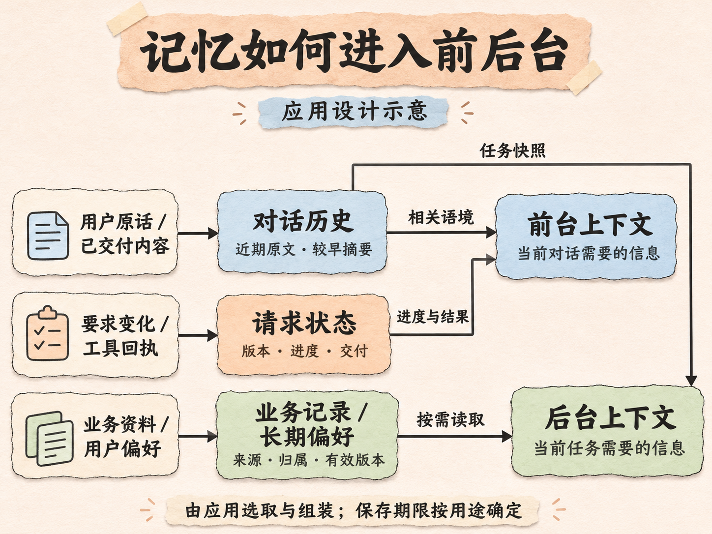

# Voice Agent 实践与落地（三）：前后台分离与记忆管理

最初开发 Mina 时，我们把 Agent loop 和工具调用都放在语音前台。模型收到请求后调用工具，等结果回来，再决定继续执行还是回答。任务一旦需要多轮推理和工具调用，用户就要等完整个过程；期间追加的要求，也要设法送入正在执行的工作。

后来深入分析 Codex 的语音实现，我们看到它把实时对话与业务执行分开：用户继续讲话，后台继续工作，后续输入还能进入已有任务。调研期间，Pipecat 推出了 `LLMWithBackend`，LiveKit 也提供异步工具和 Talker–Reasoner 模式。这让我们开始考虑怎样把已有的业务 Agent 接到语音入口后面。

下面用一项会议任务说明这个过程。假设用户提出：

> 把这次会议的行动项整理成提案。

后台需要读取会议转写、分析行动项、确认负责人，再调用工具创建提案。用户可能在执行期间补充条件，也可能在结果播报时打断。前后台分离之后，这些交互要围绕同一项工作继续进行。

## 接到要求，前台委托后台执行

负责当前语音对话的部分称为**前台**，整理与创建提案的业务 Agent 作为**后台**。前台通过委托工具把要求交给后台，这次请求按下面的顺序交接：

1. 应用收到委托，检查身份与资料范围，启动后台任务。
2. 委托工具返回受理状态，前台据此回应。
3. 后台在独立的执行过程中完成任务，之后再把结果送回前台。

**前台从受理之后就能继续对话，最终结果仍需等待后台完成。** 如果前台一直等待业务 Agent 的整个工具循环，回复仍然依赖完整执行耗时。仅把函数声明为 `async def`，只能让等待 I/O 的协程让出事件循环，具体的对话流程还要支持上述交接方式。

交接时也要传入足够的背景。“这次会议”对应哪份转写，原话是谁说的，此前是否约定了范围，都会影响后台执行。应用可以把这些信息连同用户原话复制给后台，形成执行起点的输入快照。随后发生的普通聊天留在前台，后台保留完成当前工作需要的材料。

这个例子需要业务 Agent 连续分析和调用工具。如果工作只是一次慢接口请求，也可以直接交给异步程序执行。是否增加后台模型，取决于后续步骤是否需要模型判断。

*前后台可以运行在同一进程；阻塞 I/O 和持续占用 CPU 的计算仍需分别安排到线程、进程或计算服务，避免影响音频处理。*

## 后台运行时，前台继续处理追问与补充

后台开始整理后，用户问“做到哪了”。前台要回答这项工作的进度，因此应用需要保留任务与当前会话的关联。

一种做法是在受理时给任务分配请求标识。后台报告“正在读取转写”或“正在生成提案”时，带上这个标识，应用更新对应任务的进度。前台下一次调用模型时，将这份进度与用户的追问一起传入，模型就能据此回答。这里使用的是已有执行记录，无需重新发起整理任务。

接着，用户补充：

> 只整理发布相关的。

这句话仍在修改刚才那项工作。模型需要结合近期对话理解指代，应用再检查目标任务与发言人权限，把新要求交给对应的后台执行。维护这种关联、接收进度和转发修改的逻辑，可以集中放在应用的请求协调部分。

意图判断也由此分成了不同工作：判断“只整理发布相关的”在修改哪项任务，需要对话语境；判断哪些行动项与发布相关，则需要后台已经读取的会议材料。两边各自保留所需信息，就能完成这次交接。

请求分类可以放在不同位置：

- **前台先分类**，分别调用新建、修改或查询入口。应用入口明确，前台也需要了解相应业务规则。
- **前台统一委托**，由后台结合已有任务判断输入关系。前台入口较少，后台承担更多关联和澄清工作。

## 用户修改要求，让新条件进入执行

找到任务之后，还要让后台实际使用“只整理发布相关的”这个新条件。假设后台此时正在等待转写查询返回：查询已经发出，模型也已经生成了这一步调用；新要求需要进入后续的模型输入，才能影响接下来的分析。

执行器可以采用两种方式：

- **继续当前执行**：先保存新要求，在允许追加输入的位置将它放入工作上下文，再进行下一次模型调用。例如，在工具返回后读取待处理的补充要求，连同工具结果一起交给模型。
- **替换当前执行**：停止旧计划，将原始要求、新条件和已有操作记录交给新的执行过程，重新规划后续步骤。

选择哪一种，取决于执行器是否支持持续接收输入。只修改应用里的任务记录、没有更新后续模型输入时，后台仍会沿用旧要求。

### 旧结果晚到时，按要求版本判断是否采用

修改期间，旧执行也可能刚好完成，返回一份包含全部行动项的结果。这份结果已经不符合最新范围，前台需要识别并跳过它。

应用可以在修改要求时增加版本号，让执行过程及其返回结果都关联到相应版本。例如，原要求为 v1，“只整理发布相关的”为 v2。前台准备播报时，只采用仍符合当前版本的结果；旧执行返回的进度也不能覆盖新版本的状态。同一任务的修改和结果提交可以串行处理，或使用带版本条件的原子更新。

版本在这里解决的是修改前后结果交错到达的问题。后台已经完成的业务操作，还要继续核实。

### 工具已经发出写入时，先收取回执

同一项任务也可能在更晚的时刻收到修改：后台已经发出创建提案的请求，用户这时要求把截止时间改成明天。创建请求可能已经在业务服务中生效，即使取消本地执行，也无法据此判断提案是否创建成功。

此时需要先收取创建工具的返回结果，取得提案 ID，再读取并修改这份提案。工具返回的业务 ID、操作结果和数据版本，就是后续执行要保留的回执。新计划有了这些信息，才能接着处理已经发生的操作。

| 收到修改时的情况 | 后续处理 |
|---|---|
| 尚未提交业务写入 | 可以停止旧计划，按新要求执行 |
| 写入已经发出 | 先收取回执，再确定修改动作 |
| 写入结果未知 | 先核实业务结果，暂缓自动重试或重新规划 |

用户要求取消任务时，也需要处理已经发出的写入。停止后续执行后，应用仍要确认在途操作的结果；需要撤销时，再使用业务服务提供的修改或撤销能力。

## 后台完成后，把有效结果交给前台播报

整理结束后，后台将提案结果、业务引用及所属要求版本送回应用。应用先保存这些信息，前台等到可以说话时，再把结果组织成语音。

结果到达时，用户可能正在讲话。输出侧需要等这轮输入处理完，再检查结果是否仍然有效、当前是否允许访问相关资料，然后安排播报。这样可以避免用户刚修改要求，旧结果却仍进入播放队列。

开始播报后，如果用户说“先别说了”，语音侧停止声音，已经完成的提案仍然保留。应用这时需要同时知道两件事：

- 提案已经创建，业务任务完成。
- 结果播报被打断，内容没有完整输出。

因此，任务的执行状态与结果的交付状态要分别记录。执行侧根据工具结果更新任务进度，输出侧根据播放事件记录待播报、播放完成或被打断。后续追问就可以沿用已有结果，不必再次执行创建。

*交付状态依据应用可观测到的音频发送与播放事件，不能据此保证用户实际听清了内容。*

如果后台执行到一半需要用户补充负责人，可以先返回一个待回答的问题，并保留它与任务、要求版本的关联。前台提问后，用户的回答再沿同一关联送回后台；期间要求发生变化时，要先判断这个问题是否仍然适用。

下面的时序图串起了委托、修改、追问进度和播报。图中采用写入前替换执行的分支：

*图 1：修改发生在业务写入前；若写入已经发出，需先等待回执。*

## 进入下一轮，前后台分别保留所需信息

用户接着问“刚才那份提案是谁负责的”。系统要从此前对话中理解“那份提案”的指代，再找到对应业务记录。至于后台整理时读取过的全部转写、工具参数和中间结果，通常无需随这句追问一起传给前台。

这就需要区分两种用途：哪些信息帮助继续对话，哪些信息用于继续执行或核实业务事实。前面各阶段已经产生了相应记录，可以按下一次调用的需要选取：

| 下一步要处理的事情 | 读取的信息 |
|---|---|
| 理解“刚才那份提案”等指代 | 用户原话、助手已输出内容，以及与任务或结果的关联 |
| 回答进度、接收修改 | 当前任务的要求版本、执行进度和待回答问题 |
| 继续后台分析与工具调用 | 原始要求、新条件、业务材料和工具返回结果 |
| 核实提案当前的负责人等内容 | 提案 ID、操作回执及业务服务中的最新记录 |

对话历史、任务记录和后台工作上下文可以分别保存。前台主要读取近期对话与当前任务状态；后台继续使用自己的工具消息。结果进入对话历史时，可以保留已播报的内容，也可以保留可供后续查找的结果引用，具体取决于应用的保留策略。

### 记录更新后，还要送入下一次模型调用

对于这次追问，应用可以把近期问答、当前任务已完成的状态、提案引用和播报情况放入前台输入。模型据此理解用户在问哪份提案，再按权限读取负责人等业务信息。后台整理时使用的大段转写和中间工具结果，继续留在执行记录中。

这些信息的更新时机也不同：提案 ID 来自创建工具的回执，播放情况由输出侧在播报结束或打断时记录。应用在调用前台模型前读取最新记录，组装本轮输入；使用持续的 Realtime 会话时，则要通过适配层支持的上下文更新方式送入。把数据保存到应用内存后，还需要完成这一步传递，模型才能使用变化后的信息。

应用可以用同进程对象保存这些记录，也可以通过数据库和消息在不同进程间传递。采用后者时，需要处理重复事件和乱序到达，确保较晚收到的旧进度不会覆盖当前状态。

*图 2：上下文按当前对话或任务需要组装。图中的长期偏好用于跨会话保留，需单独实现。*

### 对话变长与会话结束后的处理

会议继续进行，较早的问答会不断累积。可以把它们压缩成摘要，保留近期原话，供后续模型理解语境。摘要生成时仍可能有新消息进入，因此应用需要记住本次压缩的原片段；摘要返回后，只替换仍然匹配的部分，并保留期间追加的内容。原片段已被改写时，丢弃本次摘要。实现中可以用结构版本辅助这项检查。

对于需要在下次会话继续采用的用户偏好，要写入独立的持久记录，并在后续会话加载。Mem0 的指南讨论了每轮提取和会话结束后提取两种时机；Retell 介绍了通话后更新联系人简报、下次加载的做法。前一种方式能更早使用新信息，后一种方式减少提取次数，两者都需要处理用户对旧偏好的修正。

后台任务如果也要跨会话或进程重启继续执行，则要保存执行阶段、输入、结果引用和业务回执。恢复时先检查未确认的写入，再决定继续或重试。对话摘要提供语境，执行恢复还需要真实的任务和业务记录。

## Codex、Pipecat 与 LiveKit 怎样支持这段过程

走完这项任务后，可以看到应用要连接三部分工作：语音前台持续接收输入，后台运行工具循环，请求协调逻辑负责关联输入、进度与输出。下面的结构图概括了这些关系：

*图 3：逻辑职责可以在同一进程内实现，也可以按需要拆到不同服务。*

现成方案提供的接口各有侧重。以下只对照委托、后续输入和结果回传的实现。

### Codex：把后续输入送入已有执行轮次

*源码版本：Codex `65a5410`。*

Realtime 侧产生委托后，Codex 运行时把请求文本和相关转写交给执行侧。`StartOrSteer` 在空闲时启动新轮次，在已有允许追加输入的轮次时将新要求送入当前执行。它为前文的“继续当前执行”提供了输入入口，实际消费时机由执行链路决定。[输入路由源码](https://github.com/openai/codex/blob/65a5410f72dac1f4b40862c34ef0a8b71b12834a/codex-rs/core/src/session/turn_input.rs#L911)

结果返回时，Realtime V2 路径核对 `handoff_id`，丢弃不属于当前委托的进度更新，完成后发送回执并请求语音响应。这里的 `handoff` 表示委托执行，语音入口继续接收对话。[回传源码](https://github.com/openai/codex/blob/65a5410f72dac1f4b40862c34ef0a8b71b12834a/codex-rs/core/src/realtime_conversation.rs#L2778)

语音历史保存转写与输入关联，启动语音会话时选取近期问答和工作环境。对接已有业务 Agent 时，可以参考这种由运行时连接两边输入与结果的方式。

### Pipecat：组合前台模型与后台 Worker

`LLMWithBackend` 将前台 LLM 与持有独立工具、上下文的 `BackendLLMWorker` 配对。前台调用 `delegate` 后立即返回，后台开始工作；用户继续补充、修改或取消时，前台再次委托，由后台判断对当前工作的影响。

后台进度等信息静默进入前台上下文，供前台回答追问；需要用户回答的问题和最终结果，由前台组织表达。组件已经封装了这组委托与回传机制，应用继续处理工具的业务权限、写入幂等和恢复。[后台模型指南](https://docs.pipecat.ai/pipecat/learn/llm-with-backend)

普通慢工具也可以使用 Pipecat 的异步函数调用能力，当前文档中的 `cancel_on_interruption=False` 允许工具在对话继续时运行。后台需要继续调用模型和选择工具时，再采用双模型组合。

*`LLMWithBackend` 自 v1.13.0 引入，目前为 alpha；版本与服务兼容范围需按接入环境核对。*

### LiveKit：通过异步工具返回进度和结果

LiveKit 的工具首次调用 `await ctx.update(...)` 后，将进度放入对话上下文，前台可以回应并继续交流。后续更新在前台空闲时触发回复，工具最终通过 `return` 返回结果。这提供了任务执行期间继续对话的基础。[异步工具文档](https://docs.livekit.io/agents/logic/tools/async/)

Talker–Reasoner 示例进一步把后台模型放进异步工具中：Talker 决定需要分析时调用 `analyze(question)`，工具创建独立 `ChatContext`，交给 Reasoner 分析。前台保留委托判断，后台处理任务内容。示例传入待分析的问题，应用需要补充其他上下文，以及如何接收后续修改。[子代理委托指南](https://docs.livekit.io/agents/logic/patterns/subagent-delegation/)

*LiveKit 的 handoff 用于角色切换，`AgentTask` 用于阶段任务；本文的并发协作采用异步工具或子代理委托。*

这段分工也可以联想到此前 [OpenFGA](https://www.asterh.me/posts/juejin-7455516226238152755) 与[分代 ZGC](https://www.asterh.me/posts/juejin-7567612404570308660) 中的 fast path / slow path：根据条件选择处理路径。Voice Agent 还需要协调同时进行的对话与任务，上述输入和结果关联由运行时承担。

## Mina 的选择与实现边界

Mina 使用 Pipecat 1.14.0 组织语音处理，由独立的业务 Agent 执行任务。会议中的指令可能来自不同发言人，修改任务时还要检查资料权限、核实已经发出的写入，所以我们把请求管理放在应用层。

### 前台保留控制入口，任务修改采用替换执行

`MeetingVoiceRuntime` 绑定原话与身份，并区分新建、修改、回答和查询等入口。受理时，`MeetingRequests.start()` 复制对话消息并创建请求，再由 `_launch()` 启动独立异步任务；`TaskRunner` / `MeetingAgent` 负责业务执行。每场助手会话保留一个活动执行槽。

这种选择让前台承担了一部分业务分类，例如区分“暂停分享”与“等一下”、判断补充要求属于哪项工作，因此前台提示词也更复杂。后续可以进一步把业务分类集中到协调入口，语音侧保留明确的播放和控制操作。

修改请求时，Mina 采用前文的替换执行方式。`_amend()` 增加 `revision` 并作废旧播报，`_replace()` 处理旧执行的回执后重新启动。已有写入仍未确认，或回执为 `unknown` 时，停止自动重新规划。重新执行前，在原请求消息中追加新原话和旧回执索引，保留写入回执用于去重，读取结果则重新获取。

现有测试覆盖了创建提案与修改截止时间的竞争：先取得提案 ID，再读取并修改同一份提案。等待回执发生在独立异步任务中，前台可以继续对话。需要澄清时，`ask_meeting_user` 建立带编号和版本的问题，完整播报后才接受有效回答。

### 前台读取请求快照，详细工具记录留在后台

`MeetingRequests` 在工具回执到达后更新结果与阶段。`MeetingVoiceRuntime.frontend_messages()` 把当前请求快照放入 `meeting_voice_state`，供前台下一轮读取。

结果输出前，调度器检查要求版本与资料访问状态，等语音空闲时安排 TTS。媒体层确认完整音频已经送完后调用 `mark_delivered()`，中途打断则记录 `interrupted`。对话历史保存原话、发言人、普通回复，以及后台结果完成播报后的占位引用；详细工具消息与回执留在后台执行上下文和请求记录中。

共享 Realtime 适配在后续音频发送前同步历史版本与请求状态，工具续调用期间暂缓更新。启用共享历史时，完整原生回复结束后重建连接，以受控历史初始化后续交互；这项选择会增加握手开销。

`MeetingHistory` 压缩历史时校验原片段与结构版本，避免覆盖期间追加的消息。精确回顾会议内容时，通过 `read_meeting_transcript` 读取原始转写。

### 跨会话保存与恢复的范围

| 信息 | 当前保存位置与恢复范围 |
|---|---|
| 对话历史、摘要、请求状态、后台工作消息 | Python 会话内存，当前助手会话内使用 |
| 转写、资料、提案 | 原有业务服务，按业务规则持久保存 |
| 已受理的持久作业 | Java 服务的 PostgreSQL 作业记录，按作业生命周期继续执行 |

播放打断或实时连接重建时，本地请求可以保留。整个助手会话关闭后，执行器收尾并清理内存历史。Python 执行上下文和播放位置尚未支持跨进程恢复，跨会议长期偏好也尚未接入。

需要持续运行的工作，通过工具提交给持久作业服务并取得受理回执。这样，会议内的语音交互由会话运行时管理，持久作业按业务服务的生命周期继续执行。

## 参考资料

- [OpenFGA v1.9.3：集合匹配优化](https://github.com/openfga/openfga/blob/v1.9.3/internal/graph/weight_two_resolver.go)
- [OpenFGA v1.9.3：通用关系检查](https://github.com/openfga/openfga/blob/v1.9.3/internal/graph/default_resolver.go)
- [JEP 439：分代 ZGC 的快慢路径](https://openjdk.org/jeps/439#Fast-paths-and-slow-paths)

- [Pipecat：Function Calling](https://docs.pipecat.ai/pipecat/learn/function-calling)
- [Pipecat v1.13.0：引入 LLMWithBackend](https://github.com/pipecat-ai/pipecat/releases/tag/v1.13.0)
- [Pipecat：LLM with a Backend](https://docs.pipecat.ai/pipecat/learn/llm-with-backend)
- [Pipecat：Context Summarization](https://docs.pipecat.ai/pipecat/fundamentals/context-summarization)
- [LiveKit：Talker–Reasoner 模式](https://livekit.com/blog/talker-reasoner-pattern-voice-agents)
- [LiveKit：Subagent delegation](https://docs.livekit.io/agents/logic/patterns/subagent-delegation/)
- [LiveKit：Async tools](https://docs.livekit.io/agents/logic/tools/async/)
- [LiveKit：Agents and handoffs](https://docs.livekit.io/agents/logic/agents-handoffs/)
- [LiveKit：Tasks and task groups](https://docs.livekit.io/agents/logic/tasks/)
- [LiveKit：Chat context](https://docs.livekit.io/agents/logic/chat-context/)
- [LiveKit：Diagnosing blocked event loops](https://livekit.com/blog/diagnosing-blocked-event-loops)
- [Mem0：Memory for Voice Agents](https://mem0.ai/library/agent-memory/ai-memory-for-voice-agents)
- [Retell：Smarter Memory for AI Voice Agents](https://www.retellai.com/blog/ai-voice-agent-memory)
- [Codex：实时输入的 StartOrSteer 路由](https://github.com/openai/codex/blob/65a5410f72dac1f4b40862c34ef0a8b71b12834a/codex-rs/core/src/session/turn_input.rs)
- [Codex：Realtime 委托与结果回传](https://github.com/openai/codex/blob/65a5410f72dac1f4b40862c34ef0a8b71b12834a/codex-rs/core/src/realtime_conversation.rs)
- [Codex：语音启动上下文](https://github.com/openai/codex/blob/65a5410f72dac1f4b40862c34ef0a8b71b12834a/codex-rs/core/src/realtime_context.rs)
- [Codex：语音历史协议](https://github.com/openai/codex/blob/65a5410f72dac1f4b40862c34ef0a8b71b12834a/codex-rs/protocol/src/realtime.rs)
- [Codex：语音历史持久保存](https://github.com/openai/codex/blob/65a5410f72dac1f4b40862c34ef0a8b71b12834a/codex-rs/core/src/session/realtime_history.rs)

*本文的执行与协作机制核对于 2026 年 11 月 17 日；Codex 固定到文中提交，Mina 按本地工作区实现说明。*
