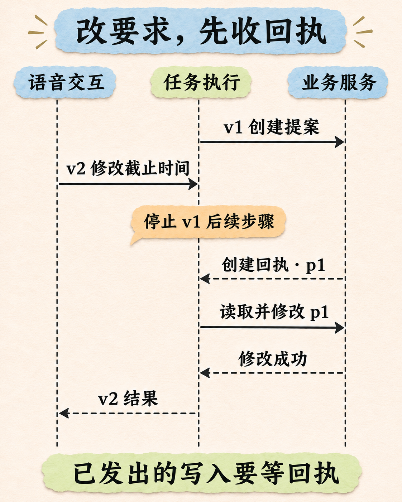

# Voice Agent 实践与落地（三）：前后台分离与记忆管理

“生成检查任务。”创建请求已经发出，用户又说了一句：“截止时间改成明天下午五点。”我们在 Mina 的测试里故意扣住了第一次调用的回执。这个时候，助手已经听懂了第二句话，却还不知道该改哪一份提案。

第一版 Mina 把工具调用和 Agent loop 都放在语音前台。比如整理会议行动项，模型先读转写，再从里面找负责人，最后调用工具创建提案。用户说完一句话，要等这几步跑完才听得到答复。要是用户中途改了主意，麦克风能收到第二句话，已经发出的模型请求里却只有第一句。

拆开这两件事的想法来自 Codex。我们读它的语音实现，发现新说的一句话还能送进已经启动的执行轮次。那段时间 Pipecat 也在 1.13.0 加入了前后台委托组件。Mina 本来就有处理会议的业务 Agent，我们决定让它接手工具循环，把语音前台留给还在说话的人。

## 前台究竟在等什么？

拿读会议转写举例。如果语音模型调用的工具里写了 `await run_agent(...)`，等数据库返回的这段时间，事件循环照样能收音频。卡住的是模型发起的这次工具调用：它要拿到返回值，才能回答用户。哪怕把查询改成异步 I/O，这个先后顺序也没变。

我们把工具的返回时机往前挪。收到委托，先核对发言人能访问哪场会议，把用户原话、会议标识和相关的前文交给独立运行的任务。任务一受理，委托工具就返回，语音模型这时有依据说“我来整理”。后台继续读转写、挑行动项，最后把提案交回来。

这两部分可以在同一个进程里运行。碰到单纯耗时的查询，一个异步任务就够了。整理提案用到后台模型，是因为读过转写才能决定接下来调哪个工具。

## 第二句话送到哪里

假设用户在整理期间开口。听起来都和同一场会议有关，处理起来却是三件事。

- **“做到哪了？”** 前台按任务标识读最新进度。如果后台刚开始读转写，照实回答就行，没必要再读一遍。
- **“由小陈跟进。”** 如果后台刚问过“这项工作由谁负责”，这句话就是问题的答案。前台把它送回那次提问，等答案的任务接着往下跑。
- **“只整理发布相关的。”** 这句话改了提案的范围。前台要找到刚才那项任务，后台要在下一次挑选行动项之前读到新条件。

最后一种最容易漏。假如读转写的请求已经发出去，改任务表里的“范围”不会改变模型刚才发出的调用。执行器得给它一个重新看要求的机会。支持追加输入的执行器，会在工具返回后把转写和补充要求一起送给模型。另一种做法是停下旧计划，带上原始要求、新条件和已经执行过的操作，重新规划。

这就引出了**要求版本**。把“整理全部行动项”记作 v1，收窄到“只整理发布相关的”后升到 v2。两次执行共用一个任务标识，但只有 v2 的结果能进入播报队列。即使 v1 晚一步交回完整清单，前台也知道那份清单已经过期。

*图 1　用户在创建提案前缩小了范围。顺着第二句要求往下看，任务仍是同一项，执行版本已经变了。*

### 创建请求已经发出，还能怎么改？

回到开头的测试。用户要改截止时间，创建工具却还没交回提案 ID。直接取消旧协程再跑一遍“生成检查任务”，有可能生成两份提案。业务服务可能已经建好了提案，只是回执还在路上。取消本地协程，撤不回那次写入。

这里有两件事值得分开等。**前台接到修改就能回应，后台要等创建回执才能动手改。** 前台先记下“明天下午五点”，把要求升到 v2，撤下旧的待播报内容。等回执的仍然是后台。回执一到，里面有刚创建的提案 ID 和业务版本。后台按 ID 重新读提案，拿当前业务版本提交修改。这样既能接上自己刚才的写入，也能发现其间别人改过这份提案。

两个版本号各管一件事。**要求版本**决定哪一次执行还有资格跟用户说“办好了”。**提案版本**决定这次修改依据的业务记录是否仍然有效。即使旧执行已经失去播报资格，它带回来的创建回执仍然有用。

还有一种结局：创建工具超时，连业务端是否写入都没弄清楚。这时要留下“结果未知”，停住自动重试，等核实到业务记录再决定下一步。用户改口说“算了”也一样。可以立刻停掉后续步骤，已经落库的提案要通过业务接口撤销。

## “先别说了”以后，下一轮记住什么

一份提案会留下两次状态更新。

第一次来自创建工具。它返回提案 ID，执行侧记下“提案已创建”。第二次来自语音输出。如果用户在播报中途说“先别说了”，输出侧把这次播报记为“被打断”。提案还在，下一句“接着说”用同一份结果就能回答。

*图 2　右侧回到任务记录的箭头来自语音输出。只看工具回执，会漏掉用户刚才打断过播报这件事。*

要是下一句问“刚才那份提案是谁负责的”，前台模型得先知道“刚才那份”指哪个 ID。前台拿近期对话和提案引用来确定用户在问哪一份，再按 ID 去业务服务查当前负责人。把播报状态也带上，它就知道上次说到一半被打断过。整场转写、每步推理用过的材料仍留在后台。普通模型请求直接带入这些信息，持续连接的 Realtime 模型则要在处理新输入前同步会话上下文。

这里的“已交付”有个很实际的限度。Mina 能确认完整音频已经发出。用户摘下耳机，发送端看到的事件照旧。因此，哪怕已经记作“已交付”，用户说“再讲一遍”，也该沿用原结果重播。

## Codex、Pipecat 和 LiveKit 各自管到哪一步

调研这几种实现，我们关心的是同一句“改一下”能走多远。前台把话递出去之后，谁来找到原任务？任务做完了，谁再开口？

| 实现 | 第二句话怎样进入执行 | 进度和结果怎样回来 |
| --- | --- | --- |
| Codex Realtime | `StartOrSteer` 在空闲时启动轮次，有可继续的活动轮次就向它追加输入 | Realtime V2 按 `handoff_id` 核对委托，完成后请求语音响应 |
| Pipecat 的 `LLMWithBackend` | 前台再次调用 `delegate`，后台结合自己的工具和上下文判断该继续、修改还是取消 | 进度静默进入前台上下文，后台的问题和最终结果由前台转述 |
| LiveKit 的子代理示例 | Talker 调用 `analyze(question)`，Reasoner 用独立上下文分析。若要把后来的修改送进同一任务，关联逻辑由应用补上 | 异步工具首次 `await ctx.update(...)` 后对话继续，工具用 `return` 交回最终结果 |

*图 3　接入已有业务 Agent 的一种分工。中间一层关联任务、补充要求和工具回执，两边各自保留模型上下文。*

Codex 给我们的启发是保留“往现有执行里送一句话”的入口。Pipecat 把两端模型的委托和回传封装好了。LiveKit 的例子则说明，前台也能自己决定哪些问题值得交给 Reasoner。Mina 还得解决一个会议特有的问题。同一场里有多个发言人，谁有权改刚才那份提案？

## Mina 最后怎么接

我们用 Pipecat 跑语音管线，沿用已有的会议 Agent 处理业务，把新建、修改、查询和回答澄清这几个入口留给语音前台。`MeetingVoiceRuntime` 把说话人的身份和当句原话一起交给 `MeetingRequests`。这样下一位参会者说“改一下”，请求管理器手里有身份和任务归属可核对。这样做给前台多留了一项判断，它得分清“暂停分享”和口头说的“等一下”。

开头那个测试把后台的工具调用顺序固定了下来。

1. **创建**。让创建工具先收到请求，扣住回执，再提交“截止时间改成明天下午五点”。`_amend()` 此时已经返回 `amending`，要求版本到了 2。测试检查此刻只调过一次业务工具。
2. **读取**。放行回执，后台的 `_replace()` 拿到提案 `p1` 的引用，连同新要求交给下一次执行。新计划先读 `p1`。
3. **修改**。最后一次调用仍指向 `p1`，带上业务版本 7 和新的截止时间。到这里，测试才断言任务完成。

后台反过来请人补充信息，走的是另一条入口。`ask_meeting_user` 把问题编号和要求版本登记在请求上。等媒体层确认问题的音频完整发出，Mina 才开始接收这道题的答案。中间如果改了要求，旧问题随旧版本一起失效。

### 会话里怎样同步，散会后还剩什么

Mina 每轮用 `frontend_messages()` 把当前任务快照放进 `meeting_voice_state`。媒体层发完结果音频调用 `mark_delivered()`，中途被打断就记为 `interrupted`。下一轮模型读到的是更新后的状态。对话历史只给已播完的后台结果留一个引用，详细工具回执留给执行侧。

共享 Realtime 连接还有一处取舍。一次工具调用尚在续跑，中途替换上下文会打乱这次交互，所以我们把同步推迟到续调用结束。开启共享历史后，完整的原生回复结束，适配层会用本地保留的历史重建连接。这样后续输入的内容可控，代价是多一次连接握手。

会议一长，`MeetingHistory` 会压缩早期对话。生成摘要的工夫里，参会者可能又说了几句，所以写回前只替换送去压缩的那段原文，保留后来追加的消息。如果原片段也被改过，就丢掉这次摘要。有人追问“当时原话怎么说”，再用 `read_meeting_transcript` 查原始转写。

| 散会后想找回什么 | Mina 存在哪里 | 实际能恢复什么 |
| --- | --- | --- |
| 对话、摘要、活动请求、播报进度 | Python 会话内存 | 同一场助手会话内重建语音连接，仍可沿用。关闭会话后清理 |
| 会议转写、资料、提案 | 各自的业务服务 | 按权限重读原文，或凭提案 ID 找回业务记录 |
| 已受理的持久作业 | Java 服务的 PostgreSQL 作业记录 | 依照作业自身的状态继续执行 |

所以，散会再回来，用户还能找到刚才建的提案。要从被打断的那半句话接着播，还得保存播放位置。要记住“以后每次开会都这样整理”，还得把偏好单独存下来，在下一场会议加载。Mina 目前把这两类信息留在当场会话里。

## 参考资料

- 看一次新输入如何启动或追加到执行轮次。[Codex 输入路由源码](https://github.com/openai/codex/blob/65a5410f72dac1f4b40862c34ef0a8b71b12834a/codex-rs/core/src/session/turn_input.rs#L911)
- 核对 Realtime 委托如何按 ID 匹配结果、触发回复。[Codex 结果回传源码](https://github.com/openai/codex/blob/65a5410f72dac1f4b40862c34ef0a8b71b12834a/codex-rs/core/src/realtime_conversation.rs#L2778)
- 确认前后台组件进入 Pipecat 的版本。[Pipecat 1.13.0 发布记录](https://github.com/pipecat-ai/pipecat/releases/tag/v1.13.0)
- 查看前台二次委托，以及进度和待播报结果各走哪条路。[Pipecat 后台模型指南](https://docs.pipecat.ai/pipecat/learn/llm-with-backend)
- 核对第一次进度更新如何放开当前对话。[LiveKit 异步工具文档](https://docs.livekit.io/agents/logic/tools/async/)
- 查看 Talker 怎样委托分析、Reasoner 实际收到了哪些上下文。[LiveKit 子代理示例](https://docs.livekit.io/agents/logic/patterns/subagent-delegation/)
