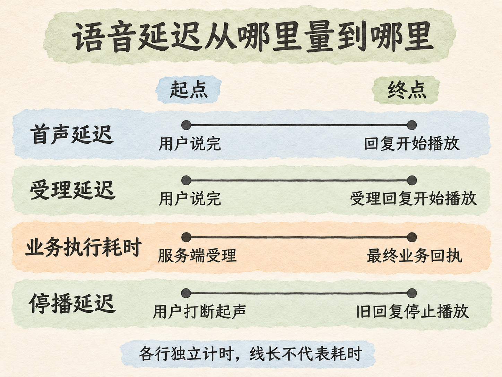

# Voice Agent 实践与落地（四）：让 AI 当测试用户，给语音 Agent 跑评测

假设给语音助手做这样一条测试。用户的列表里有两项任务，第一项 12 日截止，第二项叫“评审”，15 日截止。

> 用户：把后面那个推迟一天。
>
> 助手：你指哪一项？
>
> 用户：评审。
>
> 助手：改好了，16 日截止。

假设测试程序读回任务列表，发现第一项变成了 16 日，“评审”仍是 15 日。只看对话，这个错误就漏过去了。

## 给模拟用户一张任务卡

τ-Voice 让一个模型扮演用户，另一个 Agent 接待它。用户可以跟着助手的回复接话，任务是否完成则由业务环境验证。要测刚才那次延期，可以给用户模型这样一张卡。[τ-Voice 论文](https://arxiv.org/abs/2603.13686)

> 你想把列表里的第二项任务推迟一天。它叫“评审”，现在定在 15 日。开口时按位置说，对方问起再告诉它任务名。听到新的截止日期后结束通话。

任务卡给了用户足够的信息回答“哪一项”，也给了它结束对话的条件。内部任务 ID 留给测试程序（test harness）。如果模拟用户把 ID 直接报给助手，那么即使助手听不懂“后面那个”，也可能碰巧改对。


## “改好了”，到底改了哪一项

测试程序给这次请求留三份记录，分别对应助手说了什么、它让工具做什么，以及业务端实际改了什么。

| 观察位置 | 这通对话里看到什么 | 能得出什么结论 |
| --- | --- | --- |
| 助手回复 | “改好了，16 日截止” | 新日期说对了 |
| 工具调用 | 日期参数是 16 日，任务 ID 却指向第一项 | 助手选错了修改对象 |
| 业务端读回 | 第一项从 12 日变成 16 日，“评审”仍为 15 日 | 工具执行了这次错误写入，任务失败 |

LiveKit 的天气测试也这样拆开一轮对话。先断言模型调用了 `lookup_weather`、城市参数是 `Tokyo`，再核对工具结果，最后用 `judge()` 判断回答是否准确传达了天气。前两项可以精确匹配，“东京是晴天”则允许换一种说法。[LiveKit 单元测试](https://docs.livekit.io/testing/unit-tests/)

延期用例也分开判。程序按 ID 查两项任务的截止日期，再查本次请求的写入次数。只有第一项仍为 12 日、评审改为 16 日且只写入一次，业务断言才通过。

AI 裁判负责评回复。比如让工具明确返回“写入失败”，评分条件可以写成：“助手应告知用户修改未完成；如果它说已经延期，判失败。”LiveKit 的单消息 `judge()` 看不到整通对话，要把这条工具结果随评分条件一起给它。启用裁判前，拿一批人工标过的回答试评，看看有多少次把虚报成功的回答判成了通过。[LiveKit 评分接口](https://docs.livekit.io/testing/unit-tests/#llm-based-judgment)

## 把这通失败留下来

只回放“评审”两个字，助手一开始就知道任务名，测不到原来的指代问题。要复现这次错误，得保留用户先说“后面那个”、被追问后才报任务名的顺序。

1. **保存失败样本。** 留下初始任务、两句用户原音、助手回复和工具调用记录。先对照任务卡核实用户一直要求延期。如果模拟用户中途自行要求提前一天，把这通记为无效样本。
2. **重置数据，播放第一句。** 助手问起任务名，就播放“评审”。如果它直接执行修改，就跳过第二句，等待工具完成。设定等待超时，助手一直没回应时也能结束测试。
3. **读回结果。** 两条路径都查日期和写入次数。新版助手少问了一句也能通过，前提是改对了对象。重跑结果另存，第一次失败仍保留。

每晚可以让 AI 用户围绕任务卡自由接话，发现新的失败路径。能复现的样本保留输入、模型版本和断言，加入每次提交都跑的回归集。


## 助手正在说话时，用户插进来一声“嗯”

测打断，先让助手播一段足够长的回复，等它说到一半再送入用户录音。两版测试用同一段回复、同一个插入位置，只换用户说的话。Pipecat Evals 可以用脚本固定输入和预期事件；Full-Duplex-Bench v1.5 把主动插话和听者附和分开测，恰好能检查两种相反的错误。[Pipecat Evals](https://docs.pipecat.ai/pipecat/evals/overview.md) · [Full-Duplex-Bench v1.5](https://arxiv.org/abs/2507.23159)

| 插入的声音 | 预期行为 | 记录什么 |
| --- | --- | --- |
| “等一下，改到周五” | 停止旧回复，处理新的要求 | 有效插话中多少次按时停播，从用户起声到旧音频停播用了多久 |
| 表示附和的一声“嗯” | 继续把当前回复说完 | 有效附和中多少次发生了误停 |

断句也有类似的取舍。缩短句尾等待，用户可能更快听到回复，也可能一句话还没说完就被截断。把录音中“停一下还会继续说”的轮次单独标出来，比较版本时同时看提前截断率和首声 P95。这里的首声是从用户最后一个有效语音样本送出，量到对应回复开始播放。每轮先量完整耗时，再取第 95 百分位。尾部静音也要照常回放，等文件播完才启动计时会漏掉一段真实等待。



长任务可能先播“收到”，几秒后才播结果。两段等待都从用户说完开始算，分别到受理回复和最终结果开始播放为止。如果后一次特别慢，再按调用 ID 查工具请求何时发出、回执何时到达。设备只能记录音频到达时，就报告“接收端首声”，播放缓冲里的等待还没算进去。

## 并发测试：任务会不会串，服务能接住多少轮

**先测同一会话里交叠的两个请求。** 让测试工具收到创建请求就通知脚本，暂缓回执。脚本随即提交新的截止日期，等助手受理修改后才放行。最后按返回的任务 ID 查日期，同时确认只创建了一项任务。Codex 的 Realtime 测试用了类似手法：它扣住后台完成事件，在后台仍然运行时检查语音侧能否转发音频。这里用事件控制先后顺序，比用 `sleep` 猜时机可靠。[Codex 音频转发测试](https://github.com/openai/codex/blob/65a5410f72dac1f4b40862c34ef0a8b71b12834a/codex-rs/core/tests/suite/realtime_conversation.rs#L6163)

换成两个会话，可以让两个用户各改一项同名任务，指定不同日期，再让后发的调用先返回。分别检查两个账号的业务记录和各自听到的播报，串数据和串音频都能抓到。

**测容量要记录实际进入的对话轮数。** 同样开着 20 个房间，用户都在听时模型可能很闲，用户同时说完时却会涌进一批请求。LiveKit CLI 可以逐间派发 Agent，延迟回送语音，观察房间积累时新会话需要多久才能入会。下面是已有测试 Agent 时的示例命令。[LiveKit 多房间压测实现](https://github.com/livekit/livekit-cli/blob/b0d895355f32c642c24d7e1470168564d7c43098/pkg/loadtester/agentloadtester.go)

```sh
lk perf agent-load-test --agent-name my-agent --rooms 20 --duration 10m
```

要测入会后的业务容量，给同样数量的会话播放两份计划：一份错开句尾，另一份集中说完。保持音频长度和工具调用比例相同，逐档增加并发。可以预先保存模拟用户的音频，否则用户模型生成下一句话的速度也会影响发言频率。

压测脚本如果总等上轮答完才发下一轮，**服务越慢，脚本发得越少**。Grafana k6 的固定到达率执行器会记录计划中没能启动的迭代。语音驱动器也可以逐档记下每分钟计划发几轮、实际发几轮，以及其中成功、失败和超时各几轮。计划每分钟发 60 轮，实际只发出 40 轮，这一档的延迟只能说明 40 轮时的表现。[k6 执行器源码](https://github.com/grafana/k6/blob/master/lib/executor/constant_arrival_rate.go)

### 发布前查哪些结果

| 测试 | 报告里要能读出什么 |
| --- | --- |
| 唤醒与断句 | 有效呼叫的命中率、每小时背景音的误唤醒次数、有句中停顿样本的提前截断率 |
| 播放连续性 | 有多少回复发生缓冲耗尽、累计卡顿多久。结合接收音轨判断是否听得出卡顿，另标自然停顿和主动打断。WebRTC 的 `concealmentEvents` 可辅助定位丢包补偿 |
| 多任务与故障恢复 | 新任务按约定并行、排队或被拒绝。取消后停止新调用，撤权后不再播报受限内容，断线重连不会重复写入 |
| 阶梯、突发与持续负载 | 哪一档能同时满足首声预算和任务成功率；集中发言后队列多久恢复；负载降回基线后连接、任务和内存能否稳定 |

比较两套 Agent，可以给它们同一张任务卡、相同初始数据和轮数上限，让模拟用户分别接话，多次独立运行后按整通任务计成功率。首声和卡顿在相同负载、相同采样位置比较。至于哪套听起来更自然，可以借鉴 Speech Agent Arena，隐藏系统名、交换出场顺序，让听者分别体验。业务记录告诉你哪套更常把事办对，盲评保留听者自己的选择。[τ-Voice 交互指标](https://github.com/sierra-research/tau2-bench/blob/main/docs/interaction-metrics.md) · [Speech Agent Arena](https://artificialanalysis.ai/speech-to-speech/arena/overview)

## Mina 可以从哪条用例开始

Mina 已经有一条适合接入模拟用户的测试。创建提案的工具暂缓回执，测试在这时提交新的截止时间。请求进入 `amending`、要求版本升到 2，而创建工具仍然只调用了一次。放行回执后，再核对执行器读取并修改的是刚创建的那份提案。这些检查可以原样留下。

现有的语音测试也能说明哪些数据可以拿来评分。

- **唤醒。** 同样三种合成声音、9 条正样本，阈值固定为 0.25，换词表后命中从 7/9 变成 8/9。新增的是一句“Hey Mina”，同一声音单独说“米娜”仍会漏检。6 段背景音一共只有 16.72 秒，两版都没误触发，还不足以估计会议里每小时会误唤醒几次。
- **会议接收端。** Pipecat 1.14.0 的场景驱动器配合 Mina 的 Agora 适配器，让助手复述“蓝色海豚”，测试端对收到的音轨独立转写。助手没复述对，计入语音用例失败。如果启动时连不上凭据服务，两轮断言都没执行，则单独记录环境故障。
- **性能看板。** 一条 4 毫秒的 `first_answer` 来自本地模型替身，计时停在 HTTP 响应返回。性能查询现在会滤掉模拟回归、集成冒烟和离线音频样本。要报真实会议的首声 P95，还需要会议客户端记录用户说完和助手开始播放的时刻。

如果给这条提案用例接上 AI 用户，我会保留“创建请求已发出”这个触发条件，把第二句话的措辞交给模型。用户可以说“晚一天”，也可以在助手追问后才补上日期。现有断言继续检查提案 ID、日期和创建次数。这样能单独验证一件事：在相同的执行时机，换一种说法，Mina 还能不能改对同一份提案。

## 参考资料

- [Pipecat Evals 文档](https://docs.pipecat.ai/pipecat/evals/overview.md)
- [LiveKit Agents 单元测试文档](https://docs.livekit.io/testing/unit-tests/)
- [Codex Realtime 音频转发测试，提交 65a5410](https://github.com/openai/codex/blob/65a5410f72dac1f4b40862c34ef0a8b71b12834a/codex-rs/core/tests/suite/realtime_conversation.rs#L6163)
- [LiveKit CLI 多房间 Agent 压测实现](https://github.com/livekit/livekit-cli/blob/b0d895355f32c642c24d7e1470168564d7c43098/pkg/loadtester/agentloadtester.go)
- [Grafana k6 固定到达率执行器源码](https://github.com/grafana/k6/blob/master/lib/executor/constant_arrival_rate.go)
- [Full-Duplex-Bench v1.5 重叠语音评测](https://arxiv.org/abs/2507.23159)
- [WebRTC 接收端音频补偿统计定义](https://www.w3.org/TR/webrtc-stats/#dom-rtcinboundrtpstreamstats-concealmentevents)
- [τ-Voice 任务与语音交互指标](https://github.com/sierra-research/tau2-bench/blob/main/docs/interaction-metrics.md)
- [Speech Agent Arena 盲评偏好与任务判定方法](https://artificialanalysis.ai/speech-to-speech/arena/overview)
