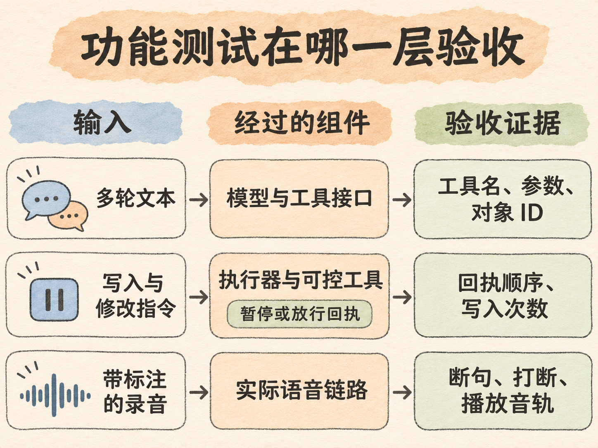

# Voice Agent 实践与落地（四）：功能测试、性能测试与自动化回归

同样是测“用户说完，多久能听到回复”，服务端和客户端可能给出两个差很多的数。服务端从确认轮次结束开始计时，到发出第一帧音频为止。用户在句尾等助手接话的那段静音，以及音频进入播放队列后的等待，都落在这两个时间点之外。

功能测试也容易遇到类似的问题。助手回答“改好了”，测试可以从转写里找到这三个字。至于它改的是哪项任务、有没有重复创建，还得往下看工具参数和业务记录。设计 Voice Agent 测试时，我会先确定每项功能在哪里验收，再选测试入口。

## 一、哪些功能值得单独验收

| 功能 | 通过条件或指标 | 去哪里取证 |
| --- | --- | --- |
| 唤醒与轮次判断 | 叫助手时能唤醒，普通谈话中少误触，句中停顿后还能接着说 | 标注过的录音、唤醒事件、轮次提交时间 |
| 响应与播报 | 普通问答看首声延迟，后台任务分别看受理延迟和完成耗时 | 客户端输入与播放音轨、后台完成回执 |
| 打断与恢复 | 打断成功率、停播延迟，旧回复会不会在下一轮又播出来 | 用户起声时间、带回复标识的播放记录 |
| 多轮上下文 | 指代命中原对象，修改后的条件生效，不同会话相互隔离 | 后续查询使用的对象 ID、参数和返回内容 |
| 工具调用 | 选对工具和参数，写入次数及最终值符合预期 | 工具轨迹、回执、业务端读回结果 |
| 多任务调度 | 连续提交遵守并行、排队或拒绝的约定，修改与取消命中目标任务 | 请求标识、要求版本、执行和交付顺序 |
| 权限与故障恢复 | 撤权后停止交付受限结果，超时或重连后能核实在途写入 | 权限变更、实际输出、业务操作记录 |

即使共用一批录音，几个比率的分母也不同。唤醒召回率按有效呼叫计，误唤醒按背景音频小时数计。评估句中停顿时，把有自然停顿且后面还有话的轮次单独分组，统计其中多少轮被提前提交。缩短句尾等待时间后，把这一组的提前截断率和首声 P95 放在一起看，才能判断响应变快付出了什么代价。

## 二、Pipecat、LiveKit 和 Codex 各自怎样写测试

**Pipecat 从用户输入开始。** Pipecat Evals 的一个 YAML 示例只写一轮。测试用户问德国首都，驱动器等到回复，再检查回答是否指出首都是柏林。在同样的脚本里，预期结果也可以是一次函数调用，或某个事件在给定时间内到达。已知回归适合固定每轮输入，便于在改动前后重跑。要探索用户换个说法、追问几轮之后的表现，可以给模拟用户设定目标，让它自行推进对话。涉及断句和打断时，用音频驱动实际语音链路，保留停顿和重叠说话的时机。

**LiveKit 展开一轮内部发生的事。** 官方天气示例给工具设置固定返回值，再检查三个连续事件。第一步核对调用的是 `lookup_weather`，城市参数是东京。第二步检查模型拿到的工具结果。第三步才评价助手有没有把天气准确告诉用户。城市选错时，第一个断言就会失败。城市和返回值都正确、回复却说错时，可以直接查模型处理工具结果的那一段。只有最后一步需要容许不同措辞。

**Codex 把断言放在后台完成之前。** 它的 Realtime 测试要验证，语音侧发起委托后，后台工作期间仍能转发音频。模拟服务先发委托和音频数据，测试程序扣住后台的完成事件。等运行时交出预期的音频帧、数据核对通过，测试才放行后台。假如先让后台结束，再查日志里有没有这帧音频，一个把音频积压到任务结束的实现也可能通过。源码里的 500 毫秒是等待运行时事件的超时，扬声器播放不在这条测试链路内。

## 三、功能测试在哪一层写

测多轮理解，可以在同一会话里放入两个不同的业务对象，再要求修改“刚才第二个”。给模型工具接口，记录它选中的 ID、修改字段和规范化后的值。换几种表达，沿用同一组预期参数。要测写入是否生效，就把用例接到可读回的测试业务服务，按 ID 查最终值。自然语言回复只承担它能验证的那部分，例如写入结果未知时，助手有没有告诉用户仍待确认。

测调度时，要先把“又来一个请求”拆清楚。新建 B 和修改 A 在语音上可能只差几个字，在执行器里却有完全不同的通过条件。

| A 执行期间收到的操作 | 怎样构造测试 | 决定结果的断言 |
| --- | --- | --- |
| 新建 B | 先让 A 占住执行槽，再提交 B | 排队时，A 释放前 B 保持等待。并行时，让 B 先完成并核对结果归属。拒绝时，B 返回拒绝状态且写入次数为零 |
| 修改 A | 分别在写入发出前、等待回执时和写入完成后提交新条件 | 旧版本的进度不覆盖新版本，后续写入作用于预期对象 |
| 取消 A | 发出写入，受理取消，然后返回回执 | 后续工具停止执行，已发出操作的结果仍有记录 |
| 撤权 | 在工具返回与播报之间撤销资料访问权 | 输出端没有交付受限内容 |
| 重连 | 在业务端已受理、客户端尚未收到结果时断开连接 | 恢复后按已有标识查询状态，同一次操作只产生一次业务写入 |

这里最有用的测试工具是一个**可暂停返回的假工具**。它收到写入后发出“已提交”信号，随后等待测试放行。测试收到信号再修改、取消或断线，便能稳定落在目标时刻。用 `sleep` 猜这个窗口，开发机与 CI 的调度差异都可能改变实际测到的分支。

文本入口适合测意图、指代和工具选择。漏唤醒、误断句和打断失败则要保留原音频。固定回放集用于版本对比，另留不同说话人、麦克风和背景噪声的样本检验泛化。打断录音尤其要保留输入与播放的时间关系，把两段语音依次送完就失去了测重叠讲话的条件。

## 四、性能测试从计时点开始

### 首声、受理和停播分别计时

- **首声延迟**从测试端送出用户末字的末个有效音频样本，量到播放端开始输出对应回复的有效语音。录音中的尾部静音要保留在链路里，起点仍取标注的语音结束位置。若只能采集接收音轨，就报告“接收端首声”，并注明采样位置。
- **长任务**可以共用用户说完这一时间点。量到受理回复首声，得到用户等确认的时间。业务执行另用服务端受理到完成回执的耗时，便于查慢工具。若目标是衡量用户等最终答复多久，再从用户说完量到结果开始播报。
- **停播延迟**从用户打断时的起声位置，量到旧回复最后一段音频停止播放。测试应保证旧回复原本还会持续播放，否则自然结束也可能被记作打断成功。把预算内停播的次数除以有效打断次数，同时报告成功样本的延迟和超时数。

端到端时间差尽量在同一个测试客户端用单调时钟计算。服务端 trace 用来解释慢在哪里。先找到慢轮次，再沿它自己的时间线看断句、模型输出、工具等待和音频缓冲。流式处理可能重叠，各阶段的 P95 也可能来自不同轮次，端到端分位数要从每轮完整耗时计算。

### 怎样施加负载

1. **单会话基线。** 固定模型、版本、区域和音频集。将建连后的首轮与复用连接的后续轮次分开，分别测短问答、工具调用、播放中打断。保存样本数、P50、P95 和超时数。
2. **阶梯并发。** 逐档增加活跃会话，每档维持相同的发言占比和工具调用配比。记录同时在线数、实际每分钟进入的轮次和完成轮次。在稳定窗口内，找出延迟与成功率同时满足目标的最高已测档位。
3. **突发流量。** 从独立会话按预定时间集中入会或发言，观察队列峰值与恢复时间。如果压测端总是等上一轮答完才发下一轮，服务一慢，到达率也会跟着降。把计划发送时间与实际发送时间都记下来，还能发现压测机自己先过载的情况。
4. **长时间运行。** 在目标负载下重复入会、退出、取消和重连。负载降回基线后，检查活动任务、连接数、内存和播放队列能否稳定下来。

比较版本时，让它们跑相同配比和到达率。每档的结果同时列出完成、失败和超时轮数。失败轮次越多，只看成功轮次的 P95 越容易高估容量。

## 五、自动化回归怎样决定一个版本能否放行

| 何时运行 | 跑哪些测试 | 怎样处理失败 |
| --- | --- | --- |
| 每次提交 | 可控工具、固定录音和状态机测试。覆盖修改、取消、去重、权限及结果归属 | 精确断言失败时阻止合并，保留预期值、实际值和事件顺序 |
| 每晚 | 同一批多轮表达和音频接真实模型，检查工具选择、断句、打断和回复内容 | 按用例比较首跑通过率，保留失败轮次。语义裁判给出的失败理由可抽样复核 |
| 发布前 | 新旧版本在相同负载下跑关键端到端用例、阶梯并发和长时间运行 | 对照产品的延迟预算、最低成功率和错误率上限，定位首次超出预算的档位 |

一次运行要能按用例单独复跑。给输入、判定规则和构建版本留标识，用同一个运行 ID 串起工具轨迹、接收端录音和转写。一次“没有收到目标回复”的失败，可以沿这条记录往回查。如果接收端已有录音，先听录音、核对转写。如果接收端全程静音，再去找运行时的音频输出和入会事件。真实模型的重跑结果追加保存，首跑失败保留在统计分母里。

用例超时和体验预算要分开配置。超时决定测试程序何时结束等待。体验预算决定这个版本能否放行。一轮语音即使在脚本超时前返回，也可能已经超出首声目标。

## 六、Mina 现有的测试能证明什么

我们在 Mina 的唤醒测试里用同一批录音比较词表。11 月 4 日那次回放包含三种合成声音、9 条正样本，检测阈值固定为 0.25。更换词表后，命中数从 7/9 变为 8/9。新增命中来自此前漏掉的一条“Hey Mina”，同一声音单独说中文“米娜”仍然漏检。这比只看总分更有用，下次调整词表时，两条样本都可以原样重跑。另有 6 段背景音共 16.72 秒，两版均无误触发。要报告会议中的每小时误唤醒次数，还需要更长的背景录音。

任务调度的证据来自受控测试。创建提案的工具暂缓回执时，测试提交新的截止时间，先断言请求已返回 `amending`、要求版本为 2，且此时只发出过一次工具调用。放行后，再核对保存的提案 ID、创建→读取→修改的调用顺序以及任务完成状态。模型轮次和工具结果都由测试预设，回归失败能直接定位到请求管理与执行顺序。真实模型对“换个截止时间”等表达的理解要通过另一组用例验收。

到了接收端，我们用 Pipecat 1.14.0 的场景驱动器和项目自己的 Agora 适配器跑中文两轮对话。脚本先发“你好，米娜”并等待应答，再要求复述“蓝色海豚”，对收到的助手音轨独立转写，检查是否包含目标词。每轮的 60 秒用于超时退出。11 月 12 日的联调中，测试端已验证语音合成和转写，会议助手启动时却连接凭据服务失败。两轮 RTC 断言都没执行，这次联调因环境启动失败而中止。评估语音行为时，分母只取实际执行了断言的用例，另外报告有多少用例未执行。

性能看板也遇到过取数边界的问题。11 月 9 日的记录里，`first_answer` 一度出现 4 毫秒。沿记录查回去，终点是本地模型替身返回 HTTP 响应。之后，性能查询排除了模拟回归、集成冒烟和离线音频环境，功能回归仍保留这些运行结果。目前这些记录能用于复查词表和任务时序。真实会议的首声 P95 和并发上限，还要靠同一轮上配对的客户端音频时间戳，以及各负载档位的完成和超时数据来测定。

## 参考资料

- [Pipecat Evals 文档](https://docs.pipecat.ai/pipecat/evals/overview.md)
- [LiveKit Agents 单元测试文档](https://docs.livekit.io/testing/unit-tests/)
- [Codex Realtime 音频转发测试，提交 65a5410](https://github.com/openai/codex/blob/65a5410f72dac1f4b40862c34ef0a8b71b12834a/codex-rs/core/tests/suite/realtime_conversation.rs#L6163)
