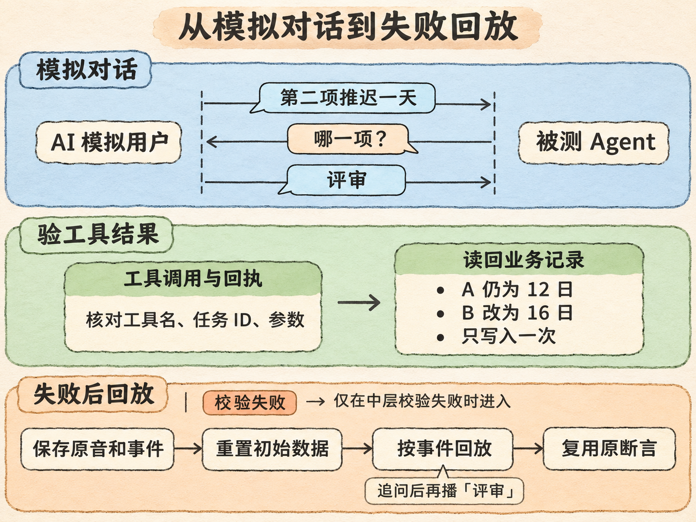

# Voice Agent 实践与落地（四）：让 AI 当测试用户，给语音 Agent 跑评测

假设给语音助手做这样一条测试。用户的列表里有两项任务，第一项 12 日截止，第二项叫“评审”，15 日截止。

> 用户：把后面那个推迟一天。
>
> 助手：你指哪一项？
>
> 用户：评审。
>
> 助手：改好了，16 日截止。

听起来，这通测试可以过了。可如果打开任务列表，看到第一项变成了 16 日，“评审”还停在 15 日呢？

这条用例有两个难点。测试用户得听懂助手的追问，知道下一句该说“评审”。测试程序又得有办法发现，助手说对了日期，工具却改错了对象。前一件事适合让模型来做，后一件事得去查业务记录。

## 给模拟用户一张任务卡

τ-Voice 的做法值得借鉴：让语音用户模拟器与被测 Agent 自由交谈，通话结束后，再到业务环境里检查任务完成情况。要跑开头那通对话，可以先给模型一张很短的任务卡。[τ-Voice 论文](https://arxiv.org/abs/2603.13686)

> 你想把列表里的第二项任务推迟一天。它叫“评审”，现在定在 15 日。开口时按位置说，对方问起再告诉它任务名。听到新的截止日期后结束通话。

同一张卡，遇到直接改对的助手，一轮就能结束；遇到需要确认的助手，用户也接得上话。这里有个容易忽略的细节：**别把内部任务 ID 塞进任务卡。** 一个急于配合的模拟用户可能主动报出 ID，替助手做完原本要测的指代判断。

初始数据、工具接口和录音都由外层测试程序（test harness）管理。它能看到完整的任务列表，也能在通话后查写入日志。模拟用户只拿到真实用户知道的信息。



## “改好了”，到底改了哪一项

接着看开头那个假设的失败。把工具调用和业务记录摊开，错在哪一步就看得出来了。

| 观察位置 | 这通对话里看到什么 | 能得出什么结论 |
| --- | --- | --- |
| 助手回复 | “改好了，16 日截止” | 新日期说对了 |
| 工具调用 | 日期参数是 16 日，任务 ID 却指向第一项 | 助手选错了修改对象 |
| 业务端读回 | 第一项从 12 日变成 16 日，“评审”仍为 15 日 | 工具执行了这次错误写入，任务失败 |

LiveKit 的天气测试也这样拆开一轮对话。先断言模型调用了 `lookup_weather`、城市参数是 `Tokyo`，再核对工具结果，最后用 `judge()` 判断回答是否准确传达了天气。前两项可以精确匹配，“东京是晴天”则允许换一种说法。[LiveKit 单元测试](https://docs.livekit.io/testing/unit-tests/)

回到延期用例，程序可以直接断言 **A 仍为 12 日、B 已改到 16 日、这次请求只写入一次**。AI 裁判适合回答另一个问题：工具明确返回失败时，助手有没有如实告诉用户？LiveKit 的单消息 `judge()` 只看待评消息和评分条件，所以要把已知的工具结果写进评分条件。涉及前几轮的澄清时，要给裁判相应的对话历史。启用自动评分前，拿人工评过的一批回答试跑，尤其留意“工具失败，助手却声称成功”会不会被判通过。[LiveKit 评分接口](https://docs.livekit.io/testing/unit-tests/#llm-based-judgment)

## 把这通失败留下来

如果只把“评审”两个字存下来，下次测试一开口就报任务名，那个指代错误可能再也碰不到。真正触发错误的是用户先说了“后面那个”，在助手追问后才补充任务名。回归用例要保留这个顺序。

1. **还原现场。** 保存两句用户原音、助手的追问、工具参数和错误写入。对照任务卡确认用户始终要求延期。如果模拟用户自己改成了“提前一天”，就记录为无效样本，并注明原因。
2. **重放到分岔处。** 把两项任务重置到 12 日和 15 日，播放第一句。只有助手追问时才播“评审”。如果新版助手第一轮就改对了，可以直接结束通话。
3. **查同一组结果。** 两条路径都检查任务 ID、最终日期和写入次数。首跑失败与重跑结果分别保留，才能看出同一版本是否时好时坏。

这也决定了自动化测试怎么排。每次提交用固定输入和可控工具跑已知回归；每晚让模拟用户自由接话，探索新的说法和追问。发现一个能复现的错误，就把它从探索集收进固定回放集，连同输入、模型版本和判定规则一起保存。


## 把回放接到语音端：同一个“嗯”，要不要停

到了语音端，光保存用户说了什么还不够。两段录音按顺序播，助手永远遇不到别人插话。Pipecat Evals 可以用脚本固定输入和预期事件。测打断时，先等助手开始播放，再在旧回复明显还没说完的位置送入用户录音。Full-Duplex-Bench v1.5 进一步区分了用户插话、听者附和、对旁人讲话和背景人声。[Pipecat Evals](https://docs.pipecat.ai/pipecat/evals/overview.md) · [Full-Duplex-Bench v1.5](https://arxiv.org/abs/2507.23159)

用同一段助手回复，只换插进来的声音，就能测两个方向的错误。

| 插入的声音 | 预期行为 | 记录什么 |
| --- | --- | --- |
| “等一下，改到周五” | 停止旧回复，处理新的要求 | 有效插话中多少次按时停播，从用户起声到旧音频停播用了多久 |
| 表示附和的一声“嗯” | 继续把当前回复说完 | 有效附和中多少次发生了误停 |

断句也有类似的取舍。缩短句尾等待，用户可能更快听到回复，也可能一句话还没说完就被截断。把录音中“停一下还会继续说”的轮次单独标出来，比较版本时同时看提前截断率和首声 P95。这里的首声是从用户最后一个有效语音样本送出，量到对应回复开始播放。每轮先量完整耗时，再取第 95 百分位。尾部静音也要照常回放，等文件播完才启动计时会漏掉一段真实等待。


长任务还得听第二次播报。助手很快说出“收到”，用户可能又等了很久才听到结果。两次播报从同一个用户句尾分别计时，定位慢工具时，再按调用 ID 查请求和回执。设备如果只能采到接收音轨，就把指标写成“接收端首声”。任务已经完成、音频已经收到、扬声器已经出声，各有自己的时间戳。

## 并发时，先看谁在等谁

**一个会话里，测试的是两个操作碰在一起会怎样。** 创建任务的工具还没返回，用户就改了截止时间。如果脚本总要等上一步完成才继续，这条分支一次也跑不到。可以让测试工具接到创建请求后暂缓回执，等新要求送达，再放行。Codex 的 Realtime 测试用了类似手法：它扣住后台完成事件，在后台仍然运行时检查语音侧能否转发音频。这里用事件控制先后顺序，比用 `sleep` 猜时机可靠。[Codex 音频转发测试](https://github.com/openai/codex/blob/65a5410f72dac1f4b40862c34ef0a8b71b12834a/codex-rs/core/tests/suite/realtime_conversation.rs#L6163)

换成两个会话，可以让两个用户各改一项同名任务，指定不同日期，再让后发的调用先返回。分别检查两个账号的业务记录和各自听到的播报，串数据和串音频都能抓到。

**许多会话同时说话，才开始测容量。** 20 个房间的用户都在听，和 20 个用户同时说完，给模型带来的负载差很多。LiveKit CLI 可以逐间派发 Agent，延迟回送语音，观察房间积累时新会话需要多久才能入会。下面是已有测试 Agent 时的示例命令。[LiveKit 多房间压测实现](https://github.com/livekit/livekit-cli/blob/b0d895355f32c642c24d7e1470168564d7c43098/pkg/loadtester/agentloadtester.go)

```sh
lk perf agent-load-test --agent-name my-agent --rooms 20 --duration 10m
```

要测入会后的业务容量，给同样数量的会话播放两份计划：一份错开句尾，另一份集中说完。保持音频长度和工具调用比例相同，逐档增加并发。可以预先保存模拟用户的音频，否则用户模型生成下一句话的速度也会影响发言频率。

压测脚本如果总等上轮答完才发下一轮，**服务越慢，脚本发得越少**。Grafana k6 的固定到达率执行器会记录计划中没能启动的迭代。语音测试也值得留下这笔账：每分钟计划发几轮，实际送进去几轮，成功、失败和超时各几轮。只有实际到达率相近，两档负载的延迟才有可比性。[k6 执行器源码](https://github.com/grafana/k6/blob/master/lib/executor/constant_arrival_rate.go)

### 发布前查哪些结果

| 测试 | 报告里要能读出什么 |
| --- | --- |
| 唤醒与断句 | 有效呼叫的命中率、每小时背景音的误唤醒次数、有句中停顿样本的提前截断率 |
| 播放连续性 | 有多少回复发生缓冲耗尽、累计卡顿多久。结合接收音轨判断是否听得出卡顿，另标自然停顿和主动打断。WebRTC 的 `concealmentEvents` 可辅助定位丢包补偿 |
| 多任务与故障恢复 | 新任务按约定并行、排队或被拒绝。取消后停止新调用，撤权后不再播报受限内容，断线重连不会重复写入 |
| 阶梯、突发与持续负载 | 哪一档能同时满足首声预算和任务成功率；集中发言后队列多久恢复；负载降回基线后连接、任务和内存能否稳定 |

比较两套 Agent，可以给它们同一张任务卡、相同初始数据和轮数上限，让模拟用户分别接话，多次独立运行后按整通任务计成功率。首声和卡顿在相同负载、相同采样位置比较。至于哪套听起来更自然，可以借鉴 Speech Agent Arena，隐藏系统名、交换出场顺序，让听者分别体验。业务记录告诉你哪套更常把事办对，盲评保留听者自己的选择。[τ-Voice 交互指标](https://github.com/sierra-research/tau2-bench/blob/main/docs/interaction-metrics.md) · [Speech Agent Arena](https://artificialanalysis.ai/speech-to-speech/arena/overview)

## Mina 可以从哪条用例开始

Mina 已经有一条适合接入模拟用户的测试。创建提案的工具暂缓回执，测试在这时提交新的截止时间。请求进入 `amending`、要求版本升到 2，而创建工具仍然只调用了一次。放行回执后，再核对执行器读取并修改的是刚创建的那份提案。这些检查可以原样留下。

现有的语音测试也能说明哪些数据可以拿来评分。

- **唤醒。** 同样三种合成声音、9 条正样本，阈值固定为 0.25，换词表后命中从 7/9 变成 8/9。新增的是一句“Hey Mina”，同一声音单独说“米娜”仍会漏检。6 段背景音一共只有 16.72 秒，两版都没误触发，还不足以估计会议里每小时会误唤醒几次。
- **会议接收端。** Pipecat 1.14.0 的场景驱动器配合 Mina 的 Agora 适配器，让助手复述“蓝色海豚”，测试端对收到的音轨独立转写。助手没复述对，计入语音用例失败。如果启动时连不上凭据服务，两轮断言都没执行，则单独记录环境故障。
- **性能看板。** 一条 4 毫秒的 `first_answer` 来自本地模型替身，计时停在 HTTP 响应返回。性能查询现在会滤掉模拟回归、集成冒烟和离线音频样本。要报真实会议的首声 P95，还需要会议客户端记录用户说完和助手开始播放的时刻。

如果接下来给 Mina 加 AI 用户，我会先把“修改在途提案”里写死的第二句话交给它。它可以说“晚一天”，也可以等助手追问后才补上日期。测试仍然去查同一个提案：改的是不是它，日期对不对，有没有多建一份。哪种说法让 Mina 改错了，就把那一通留作下一次提交的回归用例。

## 参考资料

- [Pipecat Evals 文档](https://docs.pipecat.ai/pipecat/evals/overview.md)
- [LiveKit Agents 单元测试文档](https://docs.livekit.io/testing/unit-tests/)
- [Codex Realtime 音频转发测试，提交 65a5410](https://github.com/openai/codex/blob/65a5410f72dac1f4b40862c34ef0a8b71b12834a/codex-rs/core/tests/suite/realtime_conversation.rs#L6163)
- [LiveKit CLI 多房间 Agent 压测实现](https://github.com/livekit/livekit-cli/blob/b0d895355f32c642c24d7e1470168564d7c43098/pkg/loadtester/agentloadtester.go)
- [Grafana k6 固定到达率执行器源码](https://github.com/grafana/k6/blob/master/lib/executor/constant_arrival_rate.go)
- [Full-Duplex-Bench v1.5 重叠语音评测](https://arxiv.org/abs/2507.23159)
- [WebRTC 接收端音频补偿统计定义](https://www.w3.org/TR/webrtc-stats/#dom-rtcinboundrtpstreamstats-concealmentevents)
- [τ-Voice 任务与语音交互指标](https://github.com/sierra-research/tau2-bench/blob/main/docs/interaction-metrics.md)
- [Speech Agent Arena 盲评偏好与任务判定方法](https://artificialanalysis.ai/speech-to-speech/arena/overview)
