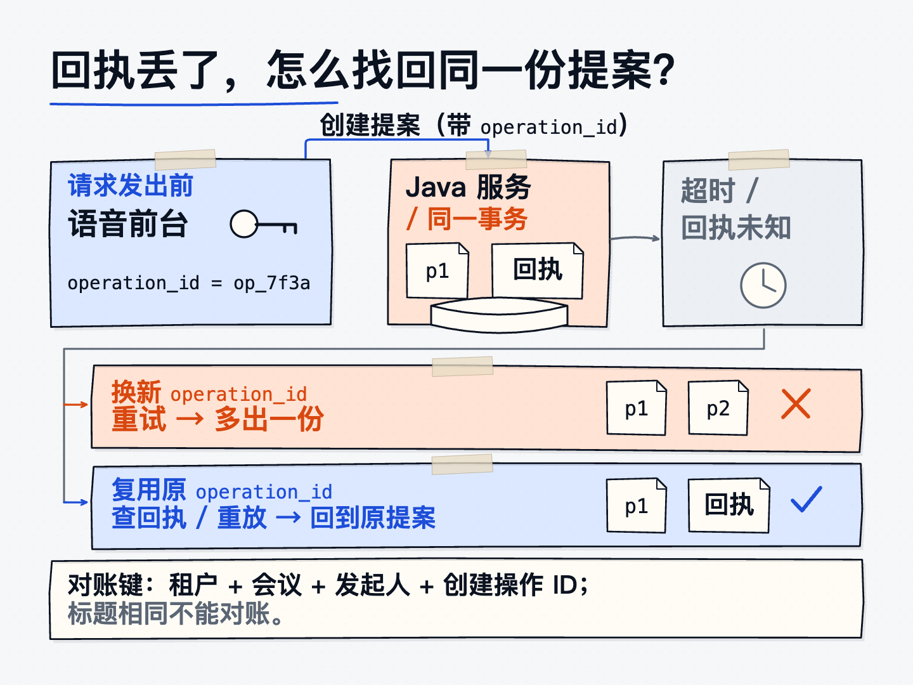
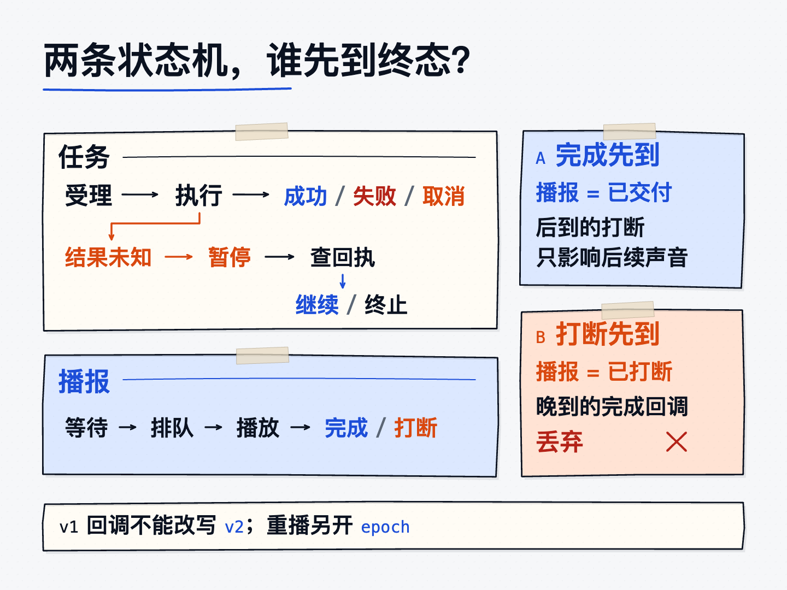

# Voice Agent 实践与落地（四）：工具调用超时，怎样重试才不会重复写入？

假设 Mina 发出“创建检查提案”的请求，数据库提交成功，返回提案 ID 的那条响应却断在了路上。从客户端看，只知道这次调用超时了。上一次创建到底成没成功？如果用户只要一份提案，下一次请求该怎么发？

在[上一篇](/posts/voice-agent-practice-03-background-memory)的测试里，回执只是晚到，等一等就拿到了提案 `p1`。这次要讨论的是回执丢了的分支。要找回 `p1`，得靠一个在它创建**之前**就有的标识。

## 第一次发送时，给这笔创建一个键

Mina 在发送写操作前分配 `operation_id`，随 MCP 请求头交给 Java 服务。用 `K1` 代表这笔创建的操作 ID。即使响应丢了，调用方手里仍有 `K1` 和当初发送的参数。

服务端收到请求，在租户、会议和发起人的范围内，用 `K1` 定位这次创建。提案和命令回执在同一事务里提交，回执带上请求摘要和业务结果。调用方再次提交相同的键和参数，服务端便能返回第一次创建的提案。同一个键带来不同内容，服务端会报冲突。用标题去匹配做不到这一点：同一场会议完全可能有两份都叫“检查”的提案。

## 按原键查了一次，为什么还不能换键？

查到回执好处理，沿着回执里的提案 ID 接着办。**最容易出错的是查询返回空的那一刻。** 假设第一笔事务还没提交，查询当然看不到它。你刚查完，它就可能提交成功。此时带 `K2` 再发一次，数据库看到两笔各有合法键的创建。即使两份请求的正文一字不差，唯一约束也会允许它们分别成立。

如果接口支持在幂等记录有效期内原样重放，同一笔创建始终用 `K1`。这样，无论第一次请求走到了哪里，都有确定的处理方式。

| 再次提交时，第一次创建到了哪里 | 同键重放后，业务端应能观察到什么 |
| --- | --- |
| 请求未到达，或事务已回滚 | 本次创建成功后留下唯一一份提案和回执 |
| 第一笔事务仍在执行 | 两次请求竞争同一个键；事务与唯一约束阻止重复提交。遇到在途或冲突响应，调用方继续按原键核实 |
| 提案与回执已提交，只有响应丢失 | 服务端识别相同请求，返回原提案的回执 |

**Mina 目前把恢复做到了哪一步？** 提案工具遇到结果未知会停下自动重跑。持久作业另有按原操作 ID 查询受理结果的入口。若要让提案在进程重启后也能安全重放，调用方还得在发送前保存操作 ID、原请求及任务归属，恢复时重新核对权限。内存里的键随进程丢失后，仅凭一句“刚才建过”无法恢复这份凭据。

## 用户改口，哪些操作要另起一笔？

“再试一次刚才的创建”沿用 `K1`。“把截止时间改到明天下午五点”改变了业务内容，要等到创建回执、取得 `p1`，再用一个新键修改这份提案。如果用户说“算了”，先停掉尚未执行的步骤。等创建结果核实后，确需撤销的提案再走撤销接口，保存这次撤销自己的回执。

还有一句特别容易混在一起：“刚才没听清，再说一遍。”这时候直接读取已有结果，另开一次播报。第一次声音被打断、完成回调晚到，都只影响那次播报的记录。已经提交的提案依然是 `p1`，不用再调创建工具。

## 怎么验证真的只有一份提案

这条回归值得故意做得比普通超时更苛刻：**先让业务端提交成功，再丢掉响应**。如果只在发送前模拟网络失败，测试根本碰不到重复创建的风险。

1. 在隔离的会议数据里，用 `K1` 创建提案。保留数据库记录，让测试客户端收不到回执。
2. 恢复连接，使用相同身份、原键和原参数重放。读回业务记录，断言只有一份提案，重放回执指向首次提交的 ID。
3. 再跑一个在途分支：暂缓第一笔提交，让查询先返回空，再以 `K1` 投递同一请求。放行并等两次调用收尾，仍应只有一份提案。另测同键换参数，断言服务端报冲突，原记录保持原值。

助手回一句“建好了”，以上三项都可能还没测到。下一篇把这个验证方法放进完整的语音对话里。[第五篇《让 AI 当测试用户，给语音 Agent 跑评测》](/posts/voice-agent-practice-04-testing-and-evaluation)

## 参考资料

- AWS Builders’ Library 用迟到请求和同键不同意图解释了幂等接口的约定。[Making retries safe with idempotent APIs](https://aws.amazon.com/builders-library/making-retries-safe-with-idempotent-APIs/)
